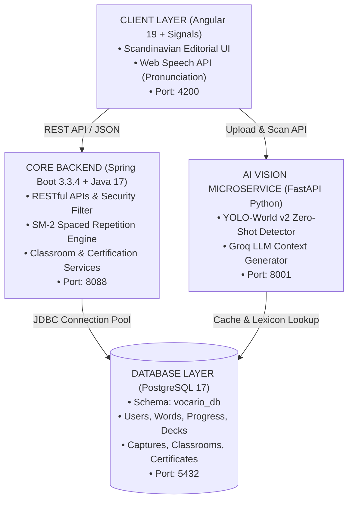
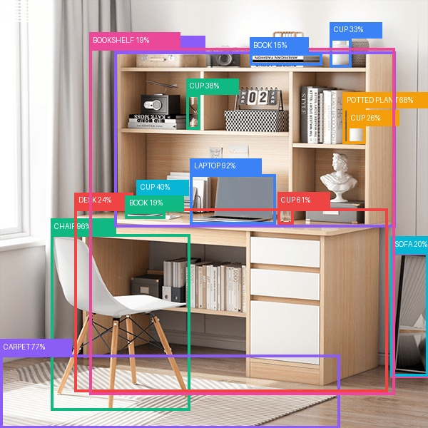
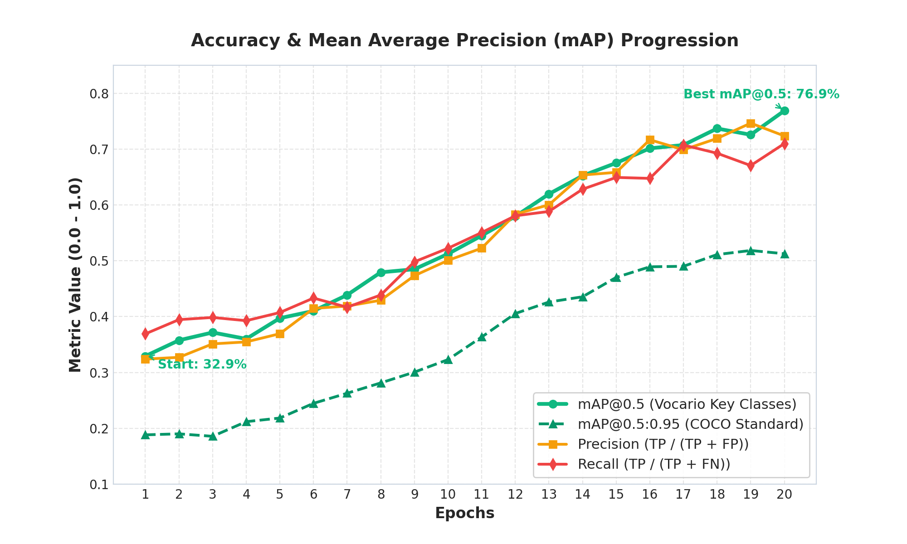
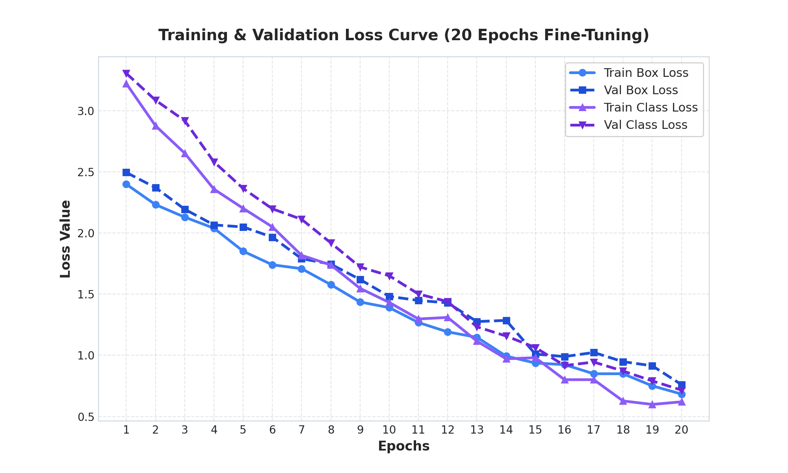

# VOCARIO — HỆ THỐNG HỌC TỪ VỰNG TIẾNG ANH NGỮ CẢNH QUA THỊ GIÁC MÁY TÍNH & THUẬT TOÁN SM-2

<p align="center">
  
  
  
  
  
  
  
</p>

> **ĐỒ ÁN TỐT NGHIỆP KỸ SƯ / CỬ NHÂN CÔNG NGHỆ THÔNG TIN**  
> **Đề tài:** Nghiên cứu và xây dựng nền tảng học từ vựng tiếng Anh theo ngữ cảnh đời thực ứng dụng mô hình nhận diện mở **YOLO-World v2**, công nghệ suy luận sinh ngôn ngữ **Groq LLM** và thuật toán ghi nhớ dài hạn **SuperMemo SM-2**.

---

## 📌 MỤC LỤC
1. [Giới Thiệu Tổng Quan](#1-giới-thiệu-tổng-quan)
2. [Kiến Trúc Hệ Thống (3-Tier Monorepo)](#2-kiến-trúc-hệ-thống)
3. [Các Phân Hệ & Tính Năng Nổi Bật](#3-các-phân-hệ--tính-năng-nổi-bật)
4. [Cấu Trúc Thư Mục Dự Án](#4-cấu-trúc-thư-mục-dự-án)
5. [Yêu Cầu Môi Trường](#5-yêu-cầu-môi-trường)
6. [Hướng Dẫn Khởi Chạy Từng Bước](#6-hướng-dẫn-khởi-chạy-từng-bước)
7. [Tài Khoản Trải Nghiệm & Demo](#7-tài-khoản-trải-nghiệm--demo)
8. [Tài Liệu API & Swagger](#8-tài-liệu-api--swagger)

---

## 1. GIỚI THIỆU TỔNG QUAN

Phương pháp học từ vựng truyền thống qua danh sách từ tĩnh (Wordlist) thường dẫn đến hiện tượng **"học vẹt và nhanh quên"** theo đường cong quên lãng Ebbinghaus. **Vocario** được nghiên cứu và phát triển nhằm chuyển đổi toàn diện trải nghiệm học từ vựng:

1. **Thị giác máy tính thế giới thực (YOLO-World v2 Zero-Shot):** Quét nhận diện mở hơn 1000+ lớp vật thể trực tiếp từ camera hoặc ảnh chụp không gian sống (bàn học, phòng khách, văn phòng, quán cà phê...).
2. **Sinh ngữ cảnh ngôn ngữ tự nhiên (Lexicon & Groq LLM):** Tự động bóc tách phiên âm chuẩn IPA (`eng-to-ipa`), đối sánh nghĩa tiếng Việt chuẩn khung CEFR và sinh câu ví dụ đàm thoại thực tế theo thời gian thực.
3. **Bộ nhớ dài hạn Spaced Repetition (SuperMemo SM-2):** Tự động tính toán chu kỳ lặp lại ngắt quãng ($I_1 = 1$ ngày, $I_2 = 6$ ngày, sau đó điều chỉnh theo hệ số $EF$) dựa trên mức độ phản xạ nhớ của học viên (Grade 0 - 5).
4. **Khảo thí & Cấp chứng chỉ năng lực CEFR (A1 - C1):** Tự động thẩm định tiến trình từ vựng thành thạo (Mastered Words) và cấp phôi chứng chỉ học thuật có mã định danh tra cứu.
5. **Cổng quản trị chuyên nghiệp (Admin Portal):** Xây dựng theo ngôn ngữ thiết kế **Scandinavian Editorial Design Tokens**, quản lý học viên, lớp học, từ điển CEFR và phân tích chất lượng âm thanh phát âm.

---

## 2. KIẾN TRÚC HỆ THỐNG

Vocario được thiết kế theo mô hình **Monorepo đa tầng (Multi-tier Clean Architecture)** đảm bảo tính mở rộng, tách bạch trách nhiệm và hiệu năng cao:



---

## 3. CÁC PHÂN HỆ & TÍNH NĂNG NỔI BẬT

### 📸 1. Studio Quét Nhận Diện Thị Giác AI (`/scanner`)
* Bóc tách tức thì tọa độ các vật thể trong không gian sống qua mô hình YOLO-World v2.
* Gắn thẻ từ vựng trực quan (Bounding Box) kèm phiên âm quốc tế IPA, định nghĩa và câu ví dụ song ngữ.
* Một chạm thêm từ vựng vào sổ tay ôn tập SM-2 cá nhân.

<p align="center">
  
  <br/><i>Minh họa kết quả nhận diện bóc tách từ vựng thực tế trong không gian bàn học sinh</i>
</p>

### 🧠 2. Phòng Luyện Ôn Thẻ Nhớ SM-2 (`/flashcards`)
* Thuật toán SuperMemo SM-2 tự động tính toán lại $EF$ (Easiness Factor) và khoảng cách ngày ôn tập tiếp theo dựa trên tự đánh giá (Grade 0 đến 5).
* Chế độ lật thẻ 3D mượt mà, phát âm giọng bản xứ tự nhiên thông qua Web Speech API.

### 🏫 3. Không Gian Phòng Học Tương Tác (`/classroom`)
* Giáo viên / Trưởng nhóm tạo phòng học, phân phối danh sách từ vựng theo chủ đề.
* Tổ chức bài kiểm tra trắc nghiệm từ vựng (Quiz Challenge) và bảng xếp hạng thành tích thời gian thực.

### 🏆 4. Khảo Thí & Chứng Chỉ Năng Lực CEFR
* Tự động phát hành chứng chỉ khảo thí các cấp độ CEFR (**A1**, **A2**, **B1**, **B2**, **C1**) khi học viên đạt chuẩn số từ vựng thành thạo ($>= 100\%$).
* Mỗi chứng chỉ sở hữu mã tra cứu độc bản (`VOC-{LEVEL}-{YEAR}-{CODE}`) cùng phôi chứng chỉ in ấn chuẩn Editorial.
* Admin có quyền duyệt, cấp đặc cách, chỉnh sửa tiêu chuẩn hoặc thu hồi chứng chỉ.

### 🛡️ 5. Cổng Quản Trị Hệ Thống Toàn Diện (`/admin`)
* **Bảng điều khiển KPI:** Biểu đồ tăng trưởng học viên, phân bố cấp độ CEFR, tỉ lệ giữ chân học tập.
* **Kho từ điển Cambridge/Oxford CEFR:** Tra cứu, thêm/sửa/xóa và lọc từ vựng theo 6 cấp độ.
* **Quản trị học viên:** Xem tiến trình SM-2, đặt lại mật khẩu, cấp mới tài khoản an toàn.
* **Kiểm duyệt ảnh AI Vision:** Quản lý nhật ký quét ảnh, gán nhãn thủ công hoặc quảng bá vật thể vào từ điển.
* **Cấu hình thuật toán:** Tùy biến tham số SM-2 ($I_1, I_2, EF_{min}, EF_{init}$) và độ nhạy nhận diện AI.

### 📊 6. Đánh Giá Thực Nghiệm Mô Hình AI (AI Model Benchmarks)
* Đồ án thực hiện đo lường khoa học các chỉ số chất lượng mô hình:
  * **Mean Average Precision (mAP@50 & mAP@50-95)** đánh giá độ chuẩn xác phát hiện vật thể.
  * **Confusion Matrix** và **Training Loss Curves** kiểm soát hiện tượng quá khớp (Overfitting).

<p align="center">
  
  
</p>

---

## 4. CẤU TRÚC THƯ MỤC DỰ ÁN

```text
DoAnTotNghiep/
├── backend/                  # AI Vision Microservice (FastAPI + YOLO-World v2)
│   ├── database/             # File schema và migration SQL
│   ├── evaluation/           # Script đo lường mAP, Precision, Recall và FPS
│   ├── services/             # AI Vision Server, Groq Generator, Lexicon Service
│   ├── Dockerfile            # Docker containerization cho Python AI Service
│   └── requirements.txt      # Danh mục dependencies Python
│
├── vocario-backend/          # Core Business Backend (Spring Boot 3 + Java 17)
│   ├── src/main/java/com/vocario/
│   │   ├── config/           # Cấu hình OpenAPI Swagger, Security, Cors, Logging
│   │   ├── controller/       # REST Controller endpoints
│   │   ├── dto/              # Data Transfer Objects
│   │   ├── entity/           # JPA Entities ánh xạ PostgreSQL
│   │   ├── repository/       # Data Access Layer (Spring Data JPA)
│   │   └── service/          # Business logic: SM-2, Certificate, Classroom
│   ├── Dockerfile            # Multi-stage Docker build (Maven + Alpine JRE 17)
│   └── pom.xml               # Maven configuration
│
├── vocario-angular/          # Frontend Web Application (Angular 19 + Tailwind CSS)
│   ├── src/app/
│   │   ├── components/       # UI Components (Admin, Scanner, Flashcard, Classroom)
│   │   ├── models/           # TypeScript Data Models
│   │   └── services/         # State Management via Angular Signals & HttpClient
│   ├── Dockerfile            # Multi-stage Docker build với Nginx Alpine
│   ├── nginx.conf            # Nginx reverse proxy & HTML5 SPA rewrite rules
│   └── package.json
│
├── docs/                     # Tài liệu kiến trúc & Thiết kế giao diện
│   ├── figures/              # Biểu đồ đánh giá độ chính xác mAP, Loss, Confusion Matrix
│   └── UI_DESIGN_SYSTEM_GUIDELINES.md
│
├── scripts/                  # Tiện ích khởi chạy & Script kiểm thử độc lập
│   ├── start_ai_service.bat  # Script khởi chạy nhanh AI Vision Server
│   └── test_detect.py        # Script kiểm thử độc lập mô hình YOLO-World
├── docker-compose.yml        # Điều phối 4 dịch vụ (PostgreSQL, AI, Spring Boot, Angular)
├── .gitignore                # Cấu hình bỏ qua tệp nháp, build cache & dữ liệu cá nhân
├── LICENSE                   # Giấy phép MIT bản quyền năm 2026
└── README.md                 # Tài liệu tổng quan dự án
```

---

## 5. KHỞI CHẠY NHANH BẰNG DOCKER (KHUYẾN NGHỊ)

Dự án đã được đóng gói toàn diện bằng **Docker** và **Docker Compose**. Khởi động toàn bộ 4 dịch vụ chỉ bằng **1 câu lệnh duy nhất**:

```bash
docker compose up -d --build
```

| Dịch vụ | Nền tảng | Cổng nội bộ | Địa chỉ truy cập |
| :--- | :--- | :---: | :--- |
| **Frontend Web App** | Angular 19 + Nginx | `80` | [http://localhost:4200](http://localhost:4200) |
| **Spring Boot Core API** | Java 17 + Temurin | `8088` | [http://localhost:8088/swagger-ui.html](http://localhost:8088/swagger-ui.html) |
| **FastAPI AI Vision** | Python 3.11 + PyTorch | `8001` | [http://localhost:8001/docs](http://localhost:8001/docs) |
| **PostgreSQL Database** | PostgreSQL 17 Alpine | `5432` | `localhost:5432` (db: `vocario_db`) |

Để dừng toàn bộ hệ thống:
```bash
docker compose down
```

---

## 6. KHỞI CHẠY THỦ CÔNG TỪNG BƯỚC (LOCAL DEV)

### Yêu Cầu Môi Trường

| Công cụ | Phiên bản khuyến nghị | Kiểm tra trong Terminal |
| :--- | :--- | :--- |
| **Java JDK** | Java 17 hoặc Java 21 LTS | `java -version` |
| **Apache Maven** | Maven 3.8+ | `mvn -v` |
| **Node.js & npm** | Node.js v18+ hoặc v20+ LTS | `node -v` && `npm -v` |
| **PostgreSQL** | PostgreSQL 15, 16 hoặc 17 | `psql -V` |
| **Python** | Python 3.10+ (64-bit) | `py --version` |

---

### Hướng Dẫn Khởi Chạy Thủ Công

### Bước 1: Khởi Tạo Cơ Sở Dữ Liệu PostgreSQL
1. Mở công cụ quản lý PostgreSQL (**pgAdmin** hoặc **DBeaver**).
2. Tạo cơ sở dữ liệu tên `vocario_db`:
   ```sql
   CREATE DATABASE vocario_db;
   ```
3. Chạy file cấu trúc dữ liệu tại: `backend/database/schema.sql`.

---

### Bước 2: Khởi Chạy Backend Spring Boot (Cổng 8088)
```powershell
cd d:\GitHub\DoAnTotNghiep\vocario-backend
mvn spring-boot:run
```
* **Swagger API Documentation:** `http://localhost:8088/swagger-ui.html`
* **Log File:** `vocario-backend/logs/vocario.log`

---

### Bước 3: Khởi Chạy AI Vision Service (Cổng 8001)
```powershell
cd d:\GitHub\DoAnTotNghiep

# 1. Cài đặt các thư viện Python (chỉ cần chạy lần đầu)
pip install -r backend/requirements.txt

# 2. Khởi chạy AI Vision FastAPI Server
py -m uvicorn backend.services.ai_vision_server:app --host 127.0.0.1 --port 8001 --reload
```
*(Hoặc click đúp chuột vào file tiện ích **`scripts\start_ai_service.bat`**).*
* **Kiểm tra trạng thái:** `http://127.0.0.1:8001/health`
* **Kiểm thử nhận diện độc lập:** `py scripts/test_detect.py`

---

### Bước 4: Khởi Chạy Frontend Angular (Cổng 4200)
```powershell
cd d:\GitHub\DoAnTotNghiep\vocario-angular
npm install
npm start
```
* **Ứng dụng Web:** `http://localhost:4200`
* **Cổng Quản Trị Admin:** `http://localhost:4200/admin`

---

## 7. TÀI KHOẢN TRẢI NGHIỆM & DEMO

| Vai trò | Email đăng nhập | Mật khẩu | Mục tiêu học tập |
| :--- | :--- | :--- | :--- |
| **Học viên mẫu** | `nam23@gmail.com` | `123456` | Chuẩn CEFR B1 / Chuỗi 3 ngày |
| **Quản trị viên** | Truy cập trực tiếp tại `/admin` | N/A | Toàn quyền kiểm duyệt hệ thống |

---

## 8. TÀI LIỆU API & SWAGGER

Hệ thống cung cấp hệ sinh thái **RESTful APIs** đạt chuẩn OpenAPI 3.0:
* **Interactive Swagger UI:** `http://localhost:8088/swagger-ui.html`
* **OpenAPI 3.0 JSON Spec:** `http://localhost:8088/v3/api-docs`

Các nhóm API chính:
1. `1. Xác thực & Hồ sơ người dùng` (Đăng ký, Đăng nhập, Profile, Mục tiêu CEFR)
2. `2. Kho từ vựng & Tra cứu ngữ cảnh` (CEFR Words, IPA, Câu ví dụ)
3. `3. Luyện tập ngắt quãng (SM-2 Spaced Repetition)` (Học mới, Ôn tập, Chấm điểm phản xạ)
4. `4. Phòng học & Bảng xếp hạng lớp học` (Tạo lớp, Quizzing, Leaderboard)
5. `5. Thị giác AI & Bóc tách bối cảnh` (YOLO-World v2 Inference, Gán nhãn)
6. `6. Khảo thí & Cấp chứng chỉ năng lực CEFR` (Tra cứu, Đăng ký cấp, Duyệt & Quản lý mẫu chứng chỉ)

---

<p align="center">
  <b>HỘI ĐỒNG CHẤM KHÓA LUẬN TỐT NGHIỆP — NĂM 2026</b><br/>
  <i>Vocario — Nền tảng công nghệ số tiên phong trong phương pháp học từ vựng ngữ cảnh thực tế.</i>
</p>
