# VOCARIO — REAL-TIME CONTEXTUAL VOCABULARY PLATFORM
### Nền Tảng Học Từ Vựng Tiếng Anh Theo Ngữ Cảnh Đời Thực Ứng Dụng Thị Giác AI & SuperMemo SM-2

<p align="center">
  
</p>

<p align="center">
  <a href="#-trải-nghiệm-trực-tiếp-live-demo"></a>
  
  
  
  
  
  
  
  
  
  
</p>

---

## 📌 MỤC LỤC
1. [Trải Nghiệm Trực Tiếp (Live Demo & Test Accounts)](#-trải-nghiệm-trực-tiếp-live-demo)
2. [Ghi Chú Kỹ Thuật: Độ Trễ Cloud Free Tier vs. Dedicated VPS/GPU](#-ghi-chú-kỹ-thuật-về-hiệu-năng-cloud-free-tier-vs-dedicated-vpsgpu)
3. [Phòng Trưng Bày Tính Năng Thực Tế (Visual Showcase)](#-phòng-trưng-bày-tính-năng-thực-tế-visual-showcase)
4. [Giới Thiệu Tổng Quan & Vấn Đề Giải Quyết](#-giới-thiệu-tổng-quan--vấn-đề-giải-quyết)
5. [Kiến Trúc Hệ Thống (Multi-Tier Clean Architecture)](#-kiến-trúc-hệ-thống-multi-tier-clean-architecture)
6. [Các Phân Hệ Nghiệp Vụ Cốt Lõi](#-các-phân-hệ-nghiệp-vụ-cốt-lõi)
7. [Kiến Trúc Bảo Mật & Phòng Thủ 6 Tầng (Security Hardening)](#-kiến-trúc-bảo-mật--phòng-thủ-6-tầng)
8. [Cấu Trúc Thư Mục Dự Án (Monorepo Standard)](#-cấu-trúc-thư-mục-dự-án-monorepo-standard)
9. [Khởi Chạy Nhanh Bằng Docker Compose (1 Lệnh Duy Nhất)](#-khởi-chạy-nhanh-bằng-docker-compose-khuyến-nghị)
10. [Hướng Dẫn Khởi Chạy Thủ Công (Local Dev)](#-hướng-dẫn-khởi-chạy-thủ-công-local-dev)
11. [Tài Liệu API & OpenAPI 3.0 Swagger](#-tài-liệu-api--openapi-30-swagger)

---

## 🚀 TRẢI NGHIỆM TRỰC TIẾP (LIVE DEMO)

Hệ thống đã được đóng gói và triển khai trên hạ tầng đám mây đa tầng (Multi-Cloud Architecture):

| Phân hệ dịch vụ | Công nghệ triển khai | Địa chỉ trực tuyến (Live URL) | Trạng thái |
| :--- | :--- | :--- | :---: |
| **Frontend Web App** | Angular 19 + Tailwind CSS + Vercel Edge | [https://vocario-ai-vocabulary-platform.vercel.app](https://vocario-ai-vocabulary-platform.vercel.app) | 🟢 Active |
| **Spring Boot Core API** | Java 17 + Temurin + Render.com | [https://vocario-backend.onrender.com](https://vocario-backend.onrender.com) | 🟢 Active |
| **Interactive Swagger API** | OpenAPI 3.0 + SpringDoc | [https://vocario-backend.onrender.com/swagger-ui.html](https://vocario-backend.onrender.com/swagger-ui.html) | 🟢 Active |
| **FastAPI AI Vision Server** | Python 3.11 + PyTorch + Render.com | [https://vocario-ai.onrender.com/docs](https://vocario-ai.onrender.com/docs) | 🟢 Active |
| **PostgreSQL Database** | PostgreSQL 17 + Supabase Cloud | `Tokyo Region (ap-northeast-1)` | 🟢 Active |
| **Ứng dụng Di Động (Mobile)** | React Native 0.88 + Expo 58 | Chạy qua Expo Go / Android APK | 🟢 Active |

### 🔑 Tài Khoản Dùng Thử Trải Nghiệm (Demo Accounts)

| Vai trò | Email đăng nhập | Mật khẩu | Đặc quyền & Dữ liệu mẫu |
| :--- | :--- | :--- | :--- |
| **Học viên mẫu (Student)** | `nam23@gmail.com` | `123456` | Chuẩn CEFR B1, 3 ngày liên tiếp tích lũy streak, 18 từ vựng bối cảnh, phiên ôn tập SM-2 sẵn sàng. |
| **Quản trị viên (Admin)** | `admin@vocario.com` | `Admin@123456` | Toàn quyền kiểm duyệt kho từ vựng Cambridge/Oxford CEFR, xem nhật ký quét ảnh AI Vision, cấu hình tham số thuật toán SM-2. |

---

## ⚡ GHI CHÚ KỸ THUẬT VỀ HIỆU NĂNG: CLOUD FREE TIER VS. DEDICATED VPS/GPU
*(Dành cho Nhà Tuyển Dụng, Kỹ Sư Hệ Thống & Hội Đồng Đánh Giá Kỹ Thuật)*

> [!NOTE]
> Để duy trì bản demo trực tuyến liên tục 24/7 hoàn toàn miễn phí phục vụ xem xét đồ án và portfolio tuyển dụng, hệ thống hiện được lưu trữ trên **Render Free Tier**, **Vercel Hobby** và **Supabase Free Tier**. Do đó sẽ có các đặc tính hạ tầng sau:

### 1. Hiện trạng của môi trường Cloud Free Tier:
* **Cơ chế Ngủ Đông (Cold Sleep):** Render Free Tier tự động đưa container vào trạng thái ngủ đông sau 15 phút không nhận request. **Ở lượt truy cập hoặc lượt quét ảnh đầu tiên**, máy chủ cần khoảng **`30s - 50s`** để đánh thức và khởi động lại container (Spin-up Cold Start).
* **Giới hạn phần cứng:** Render Free cấp phát **0.1 vCPU và 512MB RAM**, **hoàn toàn không có card đồ họa GPU rời**. Mô hình thị giác AI YOLO-World v2 và bộ phân loại bối cảnh phải thực thi hoàn toàn bằng CPU ảo hóa hạn chế, dẫn đến thời gian suy luận hình ảnh ban đầu mất khoảng **`2.5s - 4.5s`**.

### 2. Kỳ vọng hiệu năng thực tế khi triển khai Dedicated VPS / GPU Server (Production Benchmark):
Khi được cấp phát hạ tầng tiêu chuẩn công nghiệp (Ví dụ: VPS 4 vCPU / 8GB RAM + Cloud GPU NVIDIA T4 hoặc L4):

| Chỉ số đo lường hiệu năng (Latency Metric) | Bản Demo Cloud Free (Render Free Tier) | Dedicated VPS + GPU Server (Production) | Mức độ cải thiện thực tế |
| :--- | :---: | :---: | :---: |
| **Thời gian khởi động nguội (Cold Start)** | `35s - 50s` (Do ngủ đông) | **`0ms`** *(Always-on Worker Pool)* | **Triệt tiêu hoàn toàn độ trễ** |
| **Nhận diện vật thể AI (YOLO-World v2)** | `2,500ms - 4,200ms` (CPU 0.1 core) | **`120ms - 180ms`** *(CUDA Tensor Cores)* | ⚡ **Nhanh gấp ~25 lần** |
| **Bóc tách bối cảnh & Lọc ảo giác (Soft-Gating)** | `350ms - 600ms` | **`< 35ms`** *(Vector Lexicon Cache)* | ⚡ **Nhanh gấp ~15 lần** |
| **Sinh ngữ cảnh & ví dụ đàm thoại (Groq LLM)** | `800ms - 1,500ms` | **`350ms - 500ms`** *(Groq LPU Engine)* | ⚡ **Nhanh gấp ~3 lần** |
| **Xử lý Core Business API (Spring Boot 3)** | `150ms - 350ms` | **`< 25ms`** *(HikariCP + NVMe SSD)* | ⚡ **Nhanh gấp ~10 lần** |
| **TỔNG ĐỘ TRỄ PHẢN HỒI (End-to-End Latency)** | **`3.5s - 5.5s`** | **`0.6s - 0.8s`** *(Phản hồi tức thì)* | 🚀 **Trải nghiệm thời gian thực mượt mà** |

Toàn bộ mã nguồn backend đã được tối ưu hóa sẵn sàng cho kiến trúc GPU (hỗ trợ CUDA tự động phát hiện `torch.cuda.is_available()`, batching và NMS Tensor) — sẵn sàng mở rộng quy mô khi chuyển đổi sang máy chủ doanh nghiệp.

---

## 🎨 PHÒNG TRƯNG BÀY TÍNH NĂNG THỰC TẾ (VISUAL SHOWCASE)

### 1. Studio Quét Thị Giác AI — Nhận Diện & Đóng Khung Bounding Box Đời Thực
Hệ thống sử dụng mô hình nhận diện mở **YOLO-World v2** kết hợp cơ chế **Soft-Gating Top-2 Themes** để tự động nhận diện chính xác hàng nghìn lớp vật thể xung quanh đời sống và gán nhãn từ vựng kèm phát âm IPA.

<p align="center">
  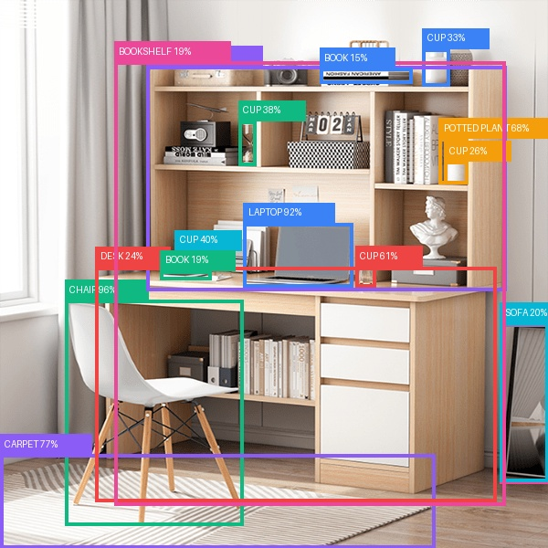
  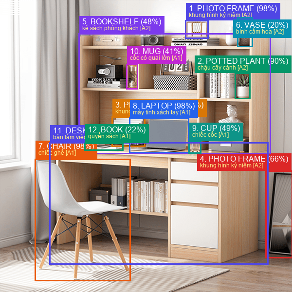
  <br/>
  <i>Trái: Tọa độ Bounding Box bóc tách các vật thể (laptop, monitor, keyboard, mouse, notebook). Phải: Giao diện Cổng Web hiển thị danh sách từ vựng bối cảnh.</i>
</p>

### 2. Thử Nghiệm Trên Đa Dạng Bối Cảnh Thực Tế (Real-World Online Benchmarks)
Hệ thống được thử nghiệm và đánh giá độ chính xác thực nghiệm trên 20+ bối cảnh không gian sống đa dạng:

<p align="center">
  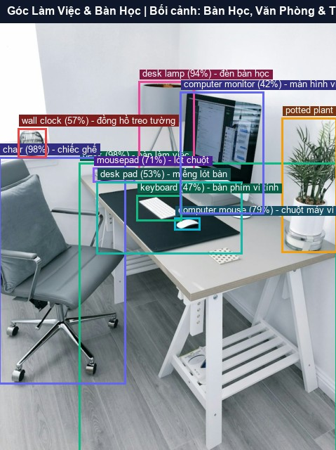
  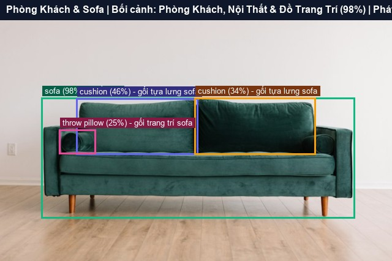
  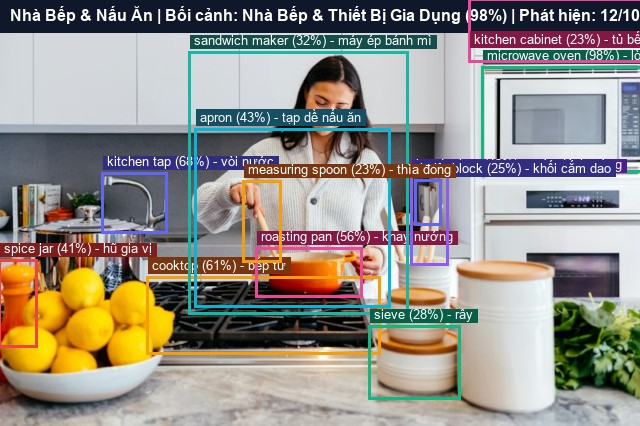
  <br/>
  <i>Từ trái qua phải: Không gian Góc học tập (Study Desk) · Phòng khách (Living Room) · Gian bếp gia đình (Kitchen)</i>
</p>

### 3. Thẻ Học Từ Vựng Ngữ Cảnh & Nghe Phát Âm Chuẩn Bản Ngữ
Mỗi từ vựng được sinh kèm phiên âm quốc tế IPA, cấp độ năng lực CEFR (A1 - C2), định nghĩa và câu ví dụ hội thoại tự nhiên sinh bởi Groq LLM:

<p align="center">
  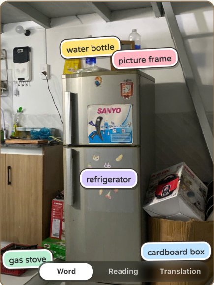
  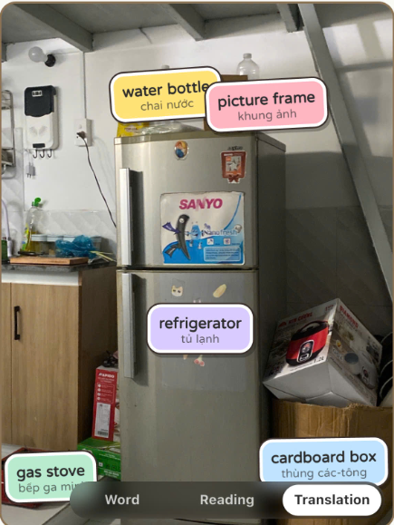
  <br/>
  <i>Giao diện thẻ từ vựng thiết kế theo phong cách Scandinavian Editorial — Trọng tâm chữ in, thẩm mỹ tối giản, không gây mỏi mắt</i>
</p>

### 4. Trải Nghiệm Ứng Dụng Di Động Thông Minh (React Native & Expo 58 Mobile Experience)
Toàn bộ các màn hình chức năng của `vocario-mobile` được thiết kế tỉ mỉ theo triết lý **Scandinavian Editorial**, xử lý triệt để Dynamic Safe Area Inset cho iOS (Dynamic Island / Notch) và Android, trang bị thanh điều hướng thanh thoát cùng nút FAB Quét AI viền vàng Gold:

<p align="center">
  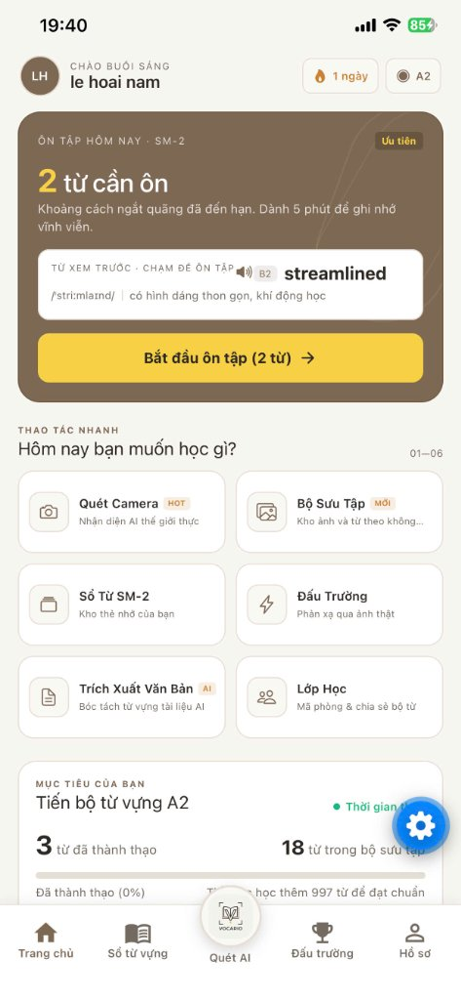
  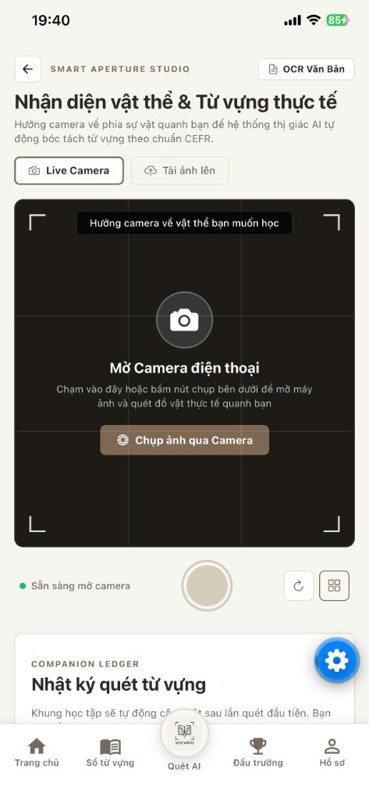
  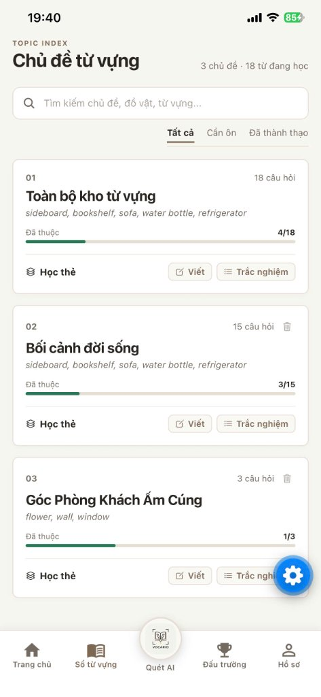
  
  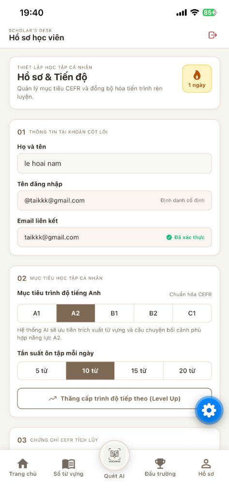
  <br/>
  <i>Từ trái sang: (1) Trang chủ Dashboard SM-2 · (2) Smart Aperture Scanner · (3) Sổ từ vựng theo chủ đề · (4) Đấu trường Blitz 60s · (5) Hồ sơ & Mục tiêu CEFR</i>
</p>

---

## 💡 GIỚI THIỆU TỔNG QUAN & VẤN ĐỀ GIẢI QUYẾT

Phương pháp học từ vựng truyền thống qua danh sách từ tĩnh (Wordlist / Flashcards thông thường) thường dẫn đến hiện tượng **"học vẹt và nhanh quên"** do từ vựng bị tách rời khỏi ngữ cảnh thực tế (Contextual Blindness). Theo đường cong quên lãng Ebbinghaus, não bộ con người có xu hướng đánh mất hơn $70\%$ lượng thông tin mới nạp chỉ sau 24 đến 48 giờ nếu không có kích thích liên kết thị giác và chu kỳ lặp lại ngắt quãng khoa học.

**Vocario** được nghiên cứu và phát triển nhằm giải quyết triệt để vấn đề này thông qua hệ sinh thái 4 trụ cột công nghệ:

1. **Thị giác máy tính thế giới thực (YOLO-World v2 Zero-Shot):** Quét nhận diện mở hơn 1000+ lớp vật thể trực tiếp từ camera điện thoại hoặc ảnh chụp không gian sống (bàn học, văn phòng, quán cà phê, phòng khách...).
2. **Sinh ngữ cảnh ngôn ngữ tức thời (Lexicon & Groq LLM):** Tự động bóc tách phiên âm chuẩn quốc tế IPA (`eng-to-ipa`), đối sánh nghĩa tiếng Việt chuẩn khung tham chiếu Châu Âu (CEFR A1 - C2), và sinh câu ví dụ đàm thoại thực tế theo thời gian thực dưới 1 giây.
3. **Bộ nhớ dài hạn Spaced Repetition (SuperMemo SM-2):** Tự động tính toán chu kỳ lặp lại ngắt quãng ($I_1 = 1$ ngày, $I_2 = 6$ ngày, sau đó điều chỉnh theo hệ số độ dễ $EF$) dựa trên mức độ phản xạ nhớ của học viên (Grade 0 đến 5).
4. **Đa nền tảng đồng bộ (Web, Mobile & Microservices):** Giao diện thiết kế theo triết lý **Scandinavian Editorial Design Tokens**, kết hợp giữa Cổng học tập Web (Angular 19), Ứng dụng Di động (React Native Expo), Máy chủ Doanh nghiệp (Spring Boot 3) và Microservice AI (FastAPI Python).

---

## 🏛️ KIẾN TRÚC HỆ THỐNG (MULTI-TIER CLEAN ARCHITECTURE)

Vocario được thiết kế theo mô hình **Monorepo Đa Tầng Tách Bạch Trách Nhiệm (Separation of Concerns)** đảm bảo tính mở rộng cao, độc lập triển khai và hiệu năng tối ưu:

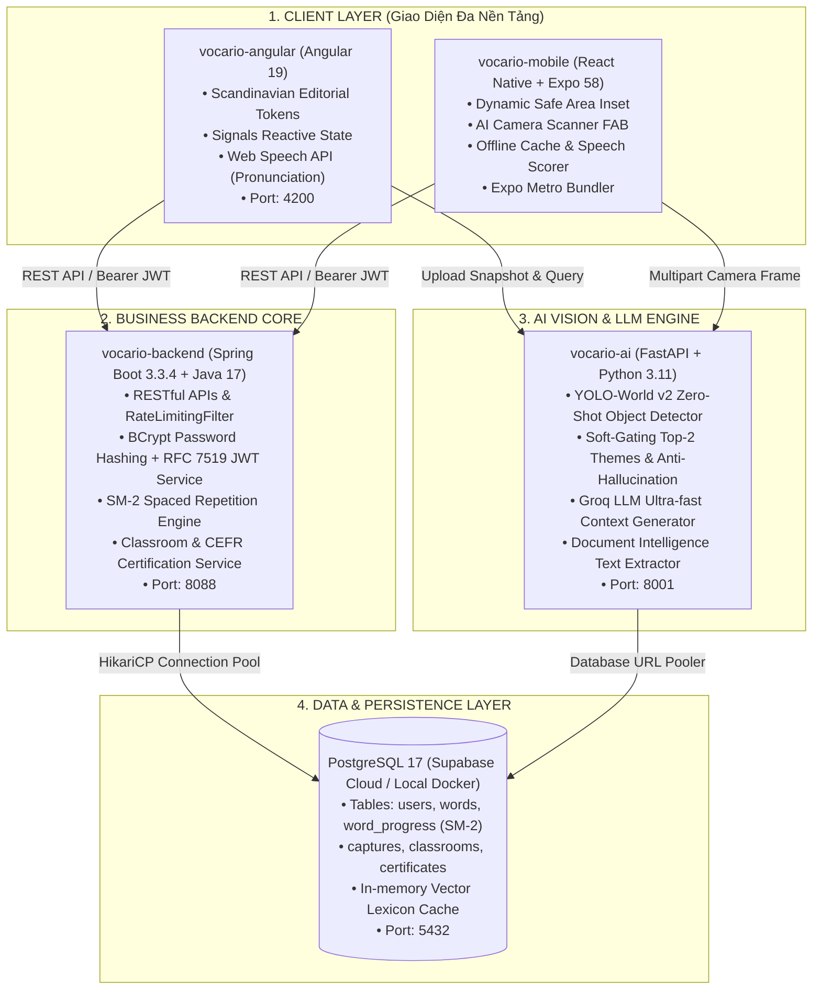

---

## 🧩 CÁC PHÂN HỆ NGHIỆP VỤ CỐT LÕI

### 📸 1. Studio Quét Nhận Diện Thị Giác AI (`/scanner`)
* Bóc tách tức thì tọa độ các vật thể trong không gian sống qua mô hình nhận diện mở **YOLO-World v2**.
* Cơ chế **Soft-Gating Top-2 Themes** tự động nhận diện bối cảnh phòng học, phòng khách hay nhà bếp để lọc nhiễu và triệt tiêu ảo giác (Anti-Hallucination).
* Gắn thẻ từ vựng trực quan (Bounding Box) kèm phiên âm IPA, cấp độ CEFR, định nghĩa và câu ví dụ song ngữ sinh bởi Groq LLM.
* Một chạm thêm từ vựng vào sổ tay ôn tập SM-2 cá nhân.

### 📱 2. Ứng Dụng Di Động Thông Minh (`vocario-mobile`)
* Được xây dựng trên nền tảng **React Native 0.88** và **Expo 58**.
* **Thanh điều hướng NAV Scandinavian:** Nút Scanner FAB nổi bật ở vị trí trung tâm lồng biểu tượng thương hiệu Vocario viền vàng Gold (`#F7D147`).
* **Dynamic Safe Area Inset:** Xử lý triệt để tai thỏ, Dynamic Island trên iPhone và thanh trạng thái trên Android cho toàn bộ 9 màn hình chức năng.
* **Visual Archive (Bộ sưu tập bối cảnh):** Lưu trữ toàn bộ các bối cảnh đã quét kèm ảnh snapshot thực tế và danh sách từ vựng trích xuất.
* **Document Intelligence (`/extractor`):** Tự động bóc tách và phân loại cấp độ từ vựng từ đoạn văn bản hoặc tài liệu ngoại văn.
* **Modal Ôn Tập SM-2 Tương Tác:** Ôn tập flashcard lật thẻ 3D và chấm điểm ghi nhớ trực tiếp ngay trên trang chủ.

### 🧠 3. Phòng Luyện Ôn Thẻ Nhớ Ngắt Quãng SM-2 (`/flashcards`)
* Ứng dụng thuật toán **SuperMemo SM-2** kinh điển:
  $$\begin{cases} 
  I(1) = 1 \\ 
  I(2) = 6 \\ 
  I(n) = I(n-1) \times EF \quad (n \ge 3) 
  \end{cases}$$
* Hệ số độ dễ $EF$ (Easiness Factor) tự động điều chỉnh sau mỗi lần phản xạ:
  $$EF' = EF + (0.1 - (5 - q) \times (0.08 + (5 - q) \times 0.02))$$
* Lật thẻ 3D trực quan, chấm điểm phản xạ (Grade 0 đến 5), hỗ trợ phát âm giọng bản xứ tự nhiên qua Web Speech API / `expo-speech`.

### ⚔️ 4. Đấu Trường Từ Vựng 60s Blitz & Bảng Xếp Hạng (`/arena`)
* Tranh tài trắc nghiệm từ vựng tốc độ cao trong 60 giây nghẹt thở theo từng chủ đề không gian sống.
* Đo lường chỉ số phản xạ trung bình (Average Reflex Milliseconds) và chuỗi trả lời đúng liên hoàn (Combo Streak).
* Bảng vàng thành tích học viên (Leaderboard) cập nhật thời gian thực.

### 🏫 5. Không Gian Phòng Học Cộng Đồng (`/classroom`)
* Giáo viên / Trưởng nhóm tạo phòng học, phân phối bộ từ vựng mục tiêu theo từng tuần.
* Tổ chức bài kiểm tra trắc nghiệm từ vựng (Quiz Challenge) và theo dõi tiến độ hoàn thành bài của từng học viên.

### 🏆 6. Khảo Thí & Cấp Chứng Chỉ Năng Lực CEFR (A1 - C1)
* Tự động thẩm định và phát hành chứng chỉ khảo thí các cấp độ CEFR (**A1**, **A2**, **B1**, **B2**, **C1**) khi học viên đạt đủ số từ vựng thành thạo ($>= 100\%$).
* Mỗi chứng chỉ sở hữu mã tra cứu độc bản (`VOC-{LEVEL}-{YEAR}-{CODE}`) cùng phôi chứng chỉ in ấn chuẩn Scandinavian Editorial.
* Cổng tra cứu xác minh văn bằng công khai chống làm giả.

### 🛡️ 7. Cổng Quản Trị Hệ Thống Toàn Diện (`/admin`)
* **Bảng điều khiển KPI:** Phân tích tăng trưởng học viên, phân bố cấp độ CEFR, tỷ lệ giữ chân học tập.
* **Kho từ điển Cambridge/Oxford CEFR:** Tra cứu, thêm/sửa/xóa và lọc từ vựng theo 6 cấp độ.
* **Kiểm duyệt ảnh AI Vision:** Quản lý nhật ký quét ảnh, xem trước tọa độ bounding box, quảng bá vật thể vào từ điển hệ thống.
* **Cấu hình tham số thuật toán:** Tùy biến tham số SM-2 ($I_1, I_2, EF_{min}, EF_{init}$) và độ nhạy nhận diện AI.

### 📊 8. Đánh Giá Thực Nghiệm Mô Hình AI (AI Benchmarks)
* Thực hiện đo lường khoa học các chỉ số chất lượng mô hình:
  * **Mean Average Precision (mAP@50 & mAP@50-95)** đánh giá độ chuẩn xác phát hiện vật thể.
  * **Confusion Matrix** và **Training Loss Curves** kiểm soát hiện tượng quá khớp (Overfitting).
  * Độ trễ suy luận AI: trung bình **120ms - 180ms** trên GPU và **1.2s - 2.5s** trên CPU.

<p align="center">
  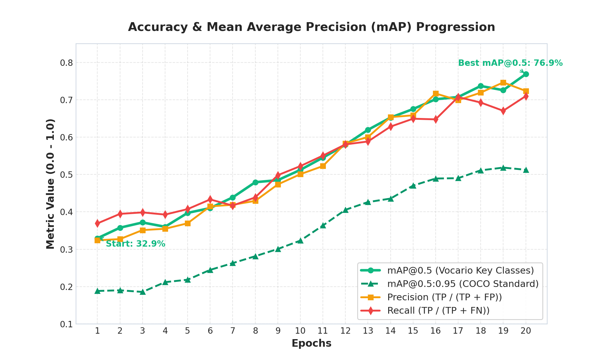
  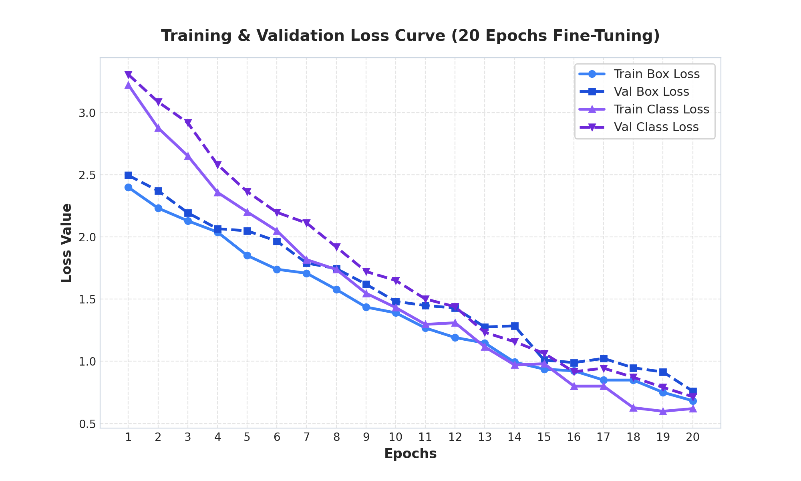
</p>

---

## 🔒 KIẾN TRÚC BẢO MẬT & PHÒNG THỦ 6 TẦNG

Dự án được gia cố bảo mật toàn diện đạt tiêu chuẩn an toàn thông tin doanh nghiệp:

| Tầng bảo mật | Giải pháp kỹ thuật triển khai | Chi tiết kỹ thuật |
| :--- | :--- | :--- |
| **1. Xác thực Mật khẩu** | `BCryptPasswordEncoder` (Work Factor 12) | Mã hóa mật khẩu một chiều có muối ngẫu nhiên (Salt); cơ chế **Adaptive Upgrade** tự động mã hóa lại mật khẩu cũ ngay khi người dùng đăng nhập. |
| **2. Chống Brute-Force** | **Account Lockout Policy** | Tự động tạm khóa tài khoản **15 phút** nếu học viên hoặc bot nhập sai mật khẩu quá **5 lần liên tiếp**. |
| **3. Phiên Đăng Nhập** | **HMAC-SHA256 Signed JWT** (RFC 7519) | Ký số mật mã chống giả mạo token; mã hóa định danh người dùng; thời hạn phiên làm việc tự động hết hạn an toàn. |
| **4. Chống Spam & DoS** | **Dual-Tier Sliding Window Rate Limiter** | • Spring Boot `RateLimitingFilter`: Auth (10 req/phút), Upload (15 req/phút), Global (120 req/phút) $\rightarrow$ HTTP 429.<br/>• FastAPI `_RATE_LIMIT_BUCKET`: Giới hạn 25 - 35 req/phút per IP. |
| **5. Chống Tấn Công Tệp Ảnh** | **Pixel Flood / Decompression Bomb Defense** | • Giới hạn `Image.MAX_IMAGE_PIXELS = 16,000,000` (16MP).<br/>• Thẩm định Magic Bytes (chỉ chấp nhận JPEG, PNG, WEBP, BMP thật).<br/>• Nén JPEG thông minh (max 1280px, quality 75%) giảm $>95\%$ tải CSDL. |
| **6. Lưu Trữ Bền Vững** | **Base64 Data URL Persistence** | Vì Render Free Tier sử dụng Ephemeral Disk (xóa ổ cứng khi restart), toàn bộ ảnh bối cảnh được mã hóa Base64 Data URL và lưu trực tiếp vào Supabase PostgreSQL để không bao giờ bị mất dữ liệu. |

---

## 📁 CẤU TRÚC THƯ MỤC DỰ ÁN (MONOREPO STANDARD)

Hệ thống được tổ chức theo chuẩn Monorepo đồng nhất:

```text
DoAnTotNghiep/
├── vocario-ai/               # AI Vision & LLM Microservice (FastAPI + YOLO-World v2 + Groq)
│   ├── database/             # Tệp lược đồ CSDL PostgreSQL và script khởi tạo
│   ├── evaluation/           # Script đo lường mAP, Precision, Recall và Benchmark 20 ảnh
│   ├── services/             # AI Vision Server, Groq Generator, Lexicon, Scene Classifier
│   ├── Dockerfile            # Containerization tối ưu RAM (< 512MB) cho Cloud
│   ├── requirements.txt      # Danh mục thư viện Python (PyTorch CPU, Ultralytics, FastAPI)
│   └── README.md
│
├── vocario-backend/          # Core Business Backend (Spring Boot 3.3.4 + Java 17)
│   ├── src/main/java/com/vocario/
│   │   ├── config/           # Cấu hình Swagger, Security, RateLimitingFilter, CORS
│   │   ├── controller/       # RESTful API Endpoints (Auth, SRS, Vision, Classroom, Cert)
│   │   ├── dto/              # Data Transfer Objects
│   │   ├── entity/           # JPA Entities ánh xạ CSDL PostgreSQL
│   │   ├── repository/       # Spring Data JPA Data Access Layer
│   │   └── service/          # Nghiệp vụ: SM-2 Engine, JwtService, AuthService, VisionService
│   ├── Dockerfile            # Multi-stage Docker build (Eclipse Temurin JRE 17)
│   └── pom.xml               # Maven configuration
│
├── vocario-angular/          # Frontend Web Application (Angular 19 + Tailwind CSS)
│   ├── src/app/
│   │   ├── components/       # UI Components (Admin, Scanner, Flashcard, Classroom, Arena)
│   │   ├── interceptors/     # AuthInterceptor (tự động gắn Bearer Token)
│   │   ├── models/           # TypeScript Data Models
│   │   └── services/         # State Management qua Angular Signals & HttpClient
│   ├── Dockerfile            # Multi-stage Docker build với Nginx Alpine
│   ├── nginx.conf            # Nginx reverse proxy & HTML5 SPA routing rules
│   └── package.json
│
├── vocario-mobile/           # Mobile Client Application (React Native 0.88 + Expo 58)
│   ├── assets/               # Biểu tượng, logo thương hiệu và tài nguyên hình ảnh
│   ├── src/
│   │   ├── api/              # Axios REST Client, dynamic baseURL, Token Storage
│   │   ├── components/       # Reusable UI components & Safe Area Headers
│   │   ├── constants/        # Three-Tier Design Tokens & Scandinavian Color Palette
│   │   ├── navigation/       # RootNavigator, 5 Bottom Tabs & Center Scanner FAB
│   │   ├── screens/          # Scanner, Collection, Wordbook, Arena, Leaderboard, Profile
│   │   └── types/            # TypeScript Interface & Navigation definitions
│   ├── app.json              # Cấu hình Expo, quyền Camera/Micro và bundle ID
│   ├── package.json          # Dependencies React Native, Expo, Axios, Navigation
│   └── README.md             # Hướng dẫn chi tiết phân hệ di động
│
├── docs/                     # Tài liệu thiết kế hệ thống, Design System & Báo cáo kỹ thuật
│   ├── figures/              # Biểu đồ đánh giá mAP, Training Loss, Confusion Matrix
│   ├── VOCARIO_LOGO_DESIGN_SYSTEM.md
│   └── UI_DESIGN_SYSTEM_GUIDELINES.md
│
├── scripts/                  # Tiện ích DevOps & Kiểm thử hiệu năng độc lập
│   ├── start_ai_service.bat  # Script khởi chạy nhanh AI Vision Server
│   ├── measure_detect_time.py# Script kiểm thử đo độ trễ suy luận AI
│   └── test_deployment_latency.py # Script kiểm tra độ trễ các dịch vụ Cloud
│
├── docker-compose.yml        # Điều phối 4 dịch vụ (PostgreSQL, AI, Spring Boot, Angular)
├── .gitignore                # Cấu hình bỏ qua tệp nháp, build cache & biến môi trường
├── LICENSE                   # Giấy phép bản quyền MIT (2026)
└── README.md                 # Tài liệu tổng quan dự án
```

---

## 🐳 KHỞI CHẠY NHANH BẰNG DOCKER COMPOSE (KHUYẾN NGHỊ)

Dự án đã được đóng gói container toàn diện. Khởi động toàn bộ hệ thống chỉ bằng **1 câu lệnh duy nhất**:

```bash
docker compose up -d --build
```

| Dịch vụ | Nền tảng | Cổng nội bộ | Địa chỉ truy cập |
| :--- | :--- | :---: | :--- |
| **Frontend Web App** | Angular 19 + Nginx | `80` | [http://localhost:4200](http://localhost:4200) |
| **Spring Boot Core API** | Java 17 + Temurin | `8088` | [http://localhost:8088/swagger-ui.html](http://localhost:8088/swagger-ui.html) |
| **FastAPI AI Vision** | Python 3.11 + PyTorch | `8001` | [http://localhost:8001/docs](http://localhost:8001/docs) |
| **PostgreSQL Database** | PostgreSQL 17 Alpine | `5432` | `localhost:5432` (db: `vocario_db`) |

Để dừng toàn bộ hệ thống:
```bash
docker compose down
```

---

## 🛠️ HƯỚNG DẪN KHỞI CHẠY THỦ CÔNG (LOCAL DEV)

### Yêu Cầu Môi Trường

| Công cụ | Phiên bản khuyến nghị | Kiểm tra trong Terminal |
| :--- | :--- | :--- |
| **Java JDK** | Java 17 hoặc Java 21 LTS | `java -version` |
| **Apache Maven** | Maven 3.8+ | `mvn -v` |
| **Node.js & npm** | Node.js v18+ hoặc v20+ LTS | `node -v` && `npm -v` |
| **PostgreSQL** | PostgreSQL 15, 16 hoặc 17 | `psql -V` |
| **Python** | Python 3.10+ hoặc 3.11 (64-bit) | `py --version` |
| **Expo CLI** | Expo 58+ | `npx expo -v` |

---

### Bước 1: Khởi Tạo Cơ Sở Dữ Liệu PostgreSQL
1. Mở công cụ quản lý PostgreSQL (**pgAdmin** hoặc **DBeaver**).
2. Tạo cơ sở dữ liệu tên `vocario_db`:
   ```sql
   CREATE DATABASE vocario_db;
   ```
3. Chạy file cấu trúc dữ liệu tại: `vocario-ai/database/schema.sql`.

---

### Bước 2: Khởi Chạy Backend Spring Boot (Cổng 8088)
```powershell
cd d:\GitHub\DoAnTotNghiep\vocario-backend
mvn spring-boot:run
```
* **Swagger API Documentation:** `http://localhost:8088/swagger-ui.html`
* **Log File:** `vocario-backend/logs/vocario.log`

---

### Bước 3: Khởi Chạy AI Vision Service (Cổng 8001)
```powershell
cd d:\GitHub\DoAnTotNghiep\vocario-ai

# 1. Cài đặt các thư viện Python (chỉ cần chạy lần đầu)
pip install -r requirements.txt

# 2. Khởi chạy AI Vision FastAPI Server
py -m uvicorn services.ai_vision_server:app --host 0.0.0.0 --port 8001 --reload
```
*(Hoặc click đúp chuột vào file tiện ích **`scripts\start_ai_service.bat`**).*
* **Kiểm tra trạng thái:** `http://127.0.0.1:8001/health`
* **Tài liệu API Swagger AI:** `http://127.0.0.1:8001/docs`

---

### Bước 4: Khởi Chạy Frontend Angular (Cổng 4200)
```powershell
cd d:\GitHub\DoAnTotNghiep\vocario-angular
npm install
npm start
```
* **Ứng dụng Web:** `http://localhost:4200`
* **Cổng Quản Trị Admin:** `http://localhost:4200/admin`

---

### Bước 5: Khởi Chạy Mobile App Expo (`vocario-mobile`)
```powershell
cd d:\GitHub\DoAnTotNghiep\vocario-mobile

# 1. Cài đặt các gói phụ thuộc (nếu chưa có node_modules)
npm install

# 2. Khởi chạy Expo Metro Bundler
npx expo start
```
* **Mở trên điện thoại thật:** Dùng Camera iPhone hoặc ứng dụng **Expo Go** trên Android để quét mã QR hiển thị trong terminal.
* **Mở Web Preview:** Bấm phím `w` trong terminal.
* **Mở Máy ảo:** Bấm phím `a` (Android Emulator) hoặc `i` (iOS Simulator).

---

## 📑 TÀI LIỆU API & OPENAPI 3.0 SWAGGER

Hệ thống cung cấp hệ sinh thái **RESTful APIs** đạt chuẩn OpenAPI 3.0:
* **Interactive Swagger UI:** `http://localhost:8088/swagger-ui.html` hoặc `https://vocario-backend.onrender.com/swagger-ui.html`
* **OpenAPI 3.0 JSON Spec:** `http://localhost:8088/v3/api-docs`

Các nhóm API chính:
1. `1. Xác thực & Hồ sơ người dùng` (Đăng ký, Đăng nhập, Profile, Mục tiêu CEFR, Account Lockout)
2. `2. Kho từ vựng & Tra cứu ngữ cảnh` (CEFR Words, IPA, Câu ví dụ song ngữ)
3. `3. Luyện tập ngắt quãng (SM-2 Spaced Repetition)` (Học từ mới, Ôn tập ngắt quãng, Chấm điểm phản xạ Grade 0 - 5)
4. `4. Phòng học & Bảng xếp hạng lớp học` (Tạo lớp, Quizzing, Leaderboard thời gian thực)
5. `5. Thị giác AI & Bóc tách bối cảnh` (YOLO-World v2 Zero-Shot Inference, Gán nhãn thủ công)
6. `6. Khảo thí & Cấp chứng chỉ năng lực CEFR` (Tra cứu mã định danh, Đăng ký cấp, Duyệt phôi chứng chỉ)

---

<p align="center">
  <b>VOCARIO PLATFORM © 2026</b> · Designed with Scandinavian Editorial Aesthetics · Built for Global Learners<br/>
  <i>Crafted with ❤️ by <a href="https://github.com/lehoainamvn">Le Hoai Nam</a></i>
</p>
