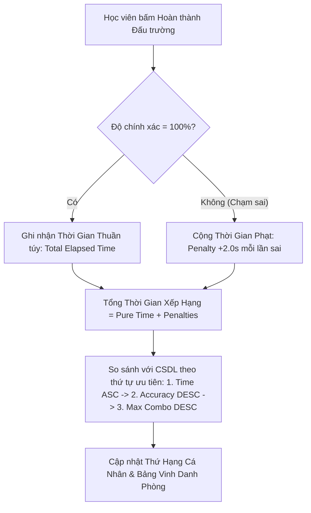

# ĐỀ ÁN THIẾT KẾ & PHÂN TÍCH CHUYÊN SÂU: HỆ THỐNG BẢNG XẾP HẠNG RIÊNG BIỆT TỪNG ĐẤU TRƯỜNG THỊ GIÁC (PER-ARENA SPEEDRUN LEADERBOARD)
## Giải Pháp Trò Chơi Hóa (Gamification) Thúc Đẩy Động Lực Phản Xạ Ngôn Ngữ Nhanh Cho Dự Án Vocario

* **Tác giả:** Đội ngũ Nghiên cứu & Phát triển Nền tảng Vocario
* **Ngày lập đề án:** 26/10/2026
* **Trạng thái:** Bản đề xuất kỹ thuật (Strictly Local - Không Push GitHub)
* **Tệp tài liệu:** `docs/proposals/PER_ARENA_LEADERBOARD_SYSTEM_ANALYSIS.md`

---

## 1. TỔNG QUAN & TẠI SAO Ý TƯỞNG "BXH RIÊNG CHO MỖI ĐẤU TRƯỜNG" LẠI CỰC KỲ XUẤT SẮC?

### 1.1. Điểm nghẽn của Bảng Xếp Hạng Tổng (Global XP Leaderboard) hiện tại
Hiện nay, Vocario sở hữu một Bảng Xếp Hạng học viên toàn hệ thống tính theo tổng điểm kinh nghiệm ($XP$) tích lũy theo tuần hoặc toàn thời gian. Tuy nhiên, mô hình BXH tổng gặp phải **3 rào cản tâm lý học hành vi lớn**:
1. **Hội chứng "Bất lực tập nhiễm" (Learned Helplessness) ở người mới:** Khi một học viên mới tham gia vào hệ thống, họ nhìn thấy Top 1 đã tích lũy $45.000\text{ XP}$ (sau hàng trăm giờ học). Họ nhận ra không bao giờ có thể bắt kịp Top 1, từ đó mất hoàn toàn động lực thi đua trên BXH chung.
2. **Thiếu tính chuyên biệt hóa (Lack of Specificity):** Một học viên có thể học rất giỏi từ vựng chủ đề *Gian Bếp (Kitchen)*, nhưng lại yếu ở chủ đề *Xưởng Cơ Khí (Workshop)*. BXH tổng gom chung mọi thứ lại làm lu mờ năng khiếu và sở trường riêng của từng người.
3. **Cày cuốc thời gian (Grinding) lấn át Tốc độ phản xạ thực thụ:** BXH điểm kinh nghiệm chỉ đo lường "ai ngồi học nhiều hơn", chứ **chưa phản ánh được "ai có phản xạ thị giác - từ vựng nhạy bén và chuẩn xác nhất"**.

### 1.2. Sức mạnh vượt trội của Bảng Xếp Hạng Riêng Biệt (Per-Arena Leaderboard)
Khi mỗi Không Gian Đấu Trường (ví dụ: *Gian Bếp Đời Thực*, *Bàn Học Sinh*, *Phòng Khách Ấm Cúng*, *Quầy Cà Phê*) sở hữu một **Bảng Xếp Hạng Độc Lập**:
* 🎯 **Mọi người đều có cơ hội trở thành Nhà Vô Địch:** Người dùng A có thể không nằm trong Top 10 toàn trường, nhưng lại là **"Kỷ Lục Gia Số 1 của Gian Bếp"** với thành tích tìm 5 vật thể chỉ trong $6.82\text{ giây}$.
* 🏎️ **Hiệu ứng "Đua thời gian" (Speedrun Competitive Psychology):** Lấy cảm hứng từ các tựa game thể thao điện tử (Esports / Racing Leaderboards), việc tính thành tích theo **Số Giây & Mili-giây** kích thích cảm giác chinh phục cực độ. Khi học viên thấy mình về nhì với $7.15\text{s}$ (chỉ thua Top 1 đúng $0.33\text{s}$), họ sẽ lập tức bấm nút **"Chơi lại" (Replay)** để bứt phá kỷ lục.
* 🧠 **Thúc đẩy phản xạ ngôn ngữ vô thức (Implicit Vocabulary Retrieval):** Để đạt thời gian dưới 5 giây, não bộ người học bị ép phải chuyển từ cơ chế dịch nhẩm chậm chạp (Explicit processing) sang cơ chế nhận diện từ vựng tức thời qua thị giác (Instant Visual-Semantic Association).

---

## 2. CƠ CHẾ TÍNH ĐIỂM & BỘ TIÊU CHÍ XẾP HẠNG TỐC ĐỘ (SPEEDRUN METRICS)

Để đảm bảo tính công bằng và chống gian lận, bảng xếp hạng của từng không gian đấu trường không thể chỉ dựa vào một yếu tố duy nhất mà áp dụng **Bộ 4 Tiêu Chí Phân Cấp Chuẩn Hóa**:



### 2.1. Tiêu chí 1 (Ưu tiên cao nhất): Tổng thời gian hoàn thành (Total Clear Time - Giây.miligiay)
* **Đơn vị đo:** Tính bằng giây và mili-giây (ví dụ: `08.45s`).
* **Quy tắc:** Thời gian càng nhỏ (nhanh hơn) thì xếp hạng càng cao.
* **Thời gian bắt đầu:** Tính từ lúc xuất hiện câu hỏi vật thể đầu tiên cho đến khi chạm đúng vật thể cuối cùng trong bối cảnh.

### 2.2. Tiêu chí 2: Hình phạt chạm sai (Mistake Time Penalty)
* Nếu học viên chạm trượt hoặc chạm nhầm vào vật thể khác:
  * Không chỉ bị trừ thời gian trong màn hình, mà còn bị **cộng thêm $+2.0\text{ giây}$ tiền phạt (Penalty Time)** vào tổng thời gian thi đấu của phòng.
  * *Mục đích sư phạm:* Ngăn chặn hành vi "chạm bừa / spam ngón tay khắp màn hình" để cầu may. Muốn lọt Top 1, người chơi bắt buộc phải vừa **Nhanh** vừa **Chính xác tuyệt đối (Clean Run)**.

### 2.3. Tiêu chí 3: Huy hiệu Hoàn Hảo (Perfect Run - 100% Accuracy)
* Nếu người chơi không phạm bất kỳ lỗi nào trong suốt 5/5 vật thể:
  * Được gắn huy hiệu **✨ Perfect Run (100% Clean)** trên bảng xếp hạng.
  * Các lượt chạy 100% Clean luôn được xếp ưu tiên hơn các lượt chạy có thời gian bằng nhau nhưng bị dính lỗi.

### 2.4. Bảng phân cấp danh hiệu theo tốc độ phản xạ

| Tốc độ hoàn thành (5 vật thể) | Tốc độ TB / vật thể | Danh hiệu vinh danh trên BXH | Phù hiệu hiển thị |
| :---: | :---: | :--- | :---: |
| **Dưới 6.00 giây** | $< 1.2\text{s}$ / từ | **⚡ Thần Điêu Thị Giác (Godlike Reflex)** | Viền Vàng Kim + Hiệu ứng Sấm sét |
| **6.01 - 10.00 giây** | $1.2\text{s} - 2.0\text{s}$ / từ | **🔥 Bậc Thầy Phản Xạ (Master Scout)** | Viền Bạc + Ngôi sao đỏ |
| **10.01 - 15.00 giây** | $2.0\text{s} - 3.0\text{s}$ / từ | **🎯 Quan Sát Tinh Tường (Keen Eye)** | Viền Đồng |
| **Trên 15.00 giây** | $> 3.0\text{s}$ / từ | **🌱 Học Viên Chăm Chỉ (Explorer)** | Thẻ chuẩn |

---

## 3. THIẾT KẾ CƠ SỞ DỮ LIỆU POSTGRESQL (DATABASE SCHEMA)

Để hỗ trợ bảng xếp hạng riêng biệt cho từng đấu trường với tốc độ truy vấn mili-giây, ta thiết kế bảng mới trong PostgreSQL Supabase: **`arena_stage_records`**.

### 3.1. Cấu trúc bảng `arena_stage_records`

```sql
-- =========================================================================
-- BẢNG LƯU KỶ LỤC VÀ LỊCH SỬ THI ĐẤU RIÊNG CHO TỪNG BỐI CẢNH ĐẤU TRƯỜNG
-- =========================================================================
CREATE TABLE IF NOT EXISTS arena_stage_records (
    id UUID PRIMARY KEY DEFAULT gen_random_uuid(),
    stage_id VARCHAR(100) NOT NULL,              -- Mã định danh bối cảnh (ví dụ: 'stage-admin-kitchen', 'scene-desk-01')
    user_id UUID NOT NULL REFERENCES users(id) ON DELETE CASCADE,
    
    -- Các chỉ số thành tích phản xạ
    completion_time_ms INTEGER NOT NULL,          -- Tổng thời gian hoàn thành (tính bằng mili-giây, ví dụ 7450 = 7.45s)
    pure_time_ms INTEGER NOT NULL,                -- Thời gian thực tế trước khi cộng phạt
    mistake_count INTEGER NOT NULL DEFAULT 0,     -- Số lần chạm trượt / sai vị trí
    penalty_ms INTEGER NOT NULL DEFAULT 0,        -- Thời gian bị phạt (mistake_count * 2000ms)
    
    -- Chỉ số chất lượng học thuật
    accuracy_pct NUMERIC(5, 2) NOT NULL,          -- Độ chính xác (ví dụ 100.00%, 80.00%)
    max_combo INTEGER NOT NULL DEFAULT 1,         -- Chuỗi combo liên hoàn cao nhất
    total_xp_earned INTEGER NOT NULL DEFAULT 0,   -- Số XP nhận được trong phiên chơi
    is_perfect_run BOOLEAN DEFAULT FALSE,        -- True nếu 0 lỗi
    
    -- Thời gian ghi nhận kỷ lục
    achieved_at TIMESTAMP WITH TIME ZONE DEFAULT CURRENT_TIMESTAMP,
    created_at TIMESTAMP WITH TIME ZONE DEFAULT CURRENT_TIMESTAMP
);

-- =========================================================================
-- INDEX TỐI ƯU HÓA TRUY VẤN TOP 10 TRONG VÒNG 1-2 MILI-GIÂY
-- =========================================================================
-- 1. Index truy vấn bảng xếp hạng phòng theo thời gian tăng dần (Time ASC)
CREATE INDEX IF NOT EXISTS idx_arena_stage_fastest 
ON arena_stage_records (stage_id, completion_time_ms ASC, accuracy_pct DESC);

-- 2. Index truy vấn kỷ lục cá nhân tốt nhất (Personal Best - PB) của học viên trong phòng này
CREATE INDEX IF NOT EXISTS idx_arena_stage_user_pb 
ON arena_stage_records (stage_id, user_id, completion_time_ms ASC);
```

### 3.2. Truy vấn mẫu lấy Top 10 Kỷ lục gia tốt nhất của 1 đấu trường (Mỗi người lấy lượt chạy tốt nhất)

```sql
SELECT 
    r.user_id,
    u.full_name,
    u.avatar_url,
    MIN(r.completion_time_ms) AS best_time_ms,
    ROUND(MIN(r.completion_time_ms) / 1000.0, 2) AS best_time_seconds,
    MAX(r.accuracy_pct) AS highest_accuracy,
    MAX(r.max_combo) AS peak_combo,
    BOOL_OR(r.is_perfect_run) AS has_perfect_run,
    MIN(r.achieved_at) AS record_achieved_at
FROM arena_stage_records r
JOIN users u ON r.user_id = u.id
WHERE r.stage_id = 'stage-admin-kitchen'
GROUP BY r.user_id, u.full_name, u.avatar_url
ORDER BY best_time_ms ASC, highest_accuracy DESC
LIMIT 10;
```

---

## 4. THIẾT KẾ TRẢI NGHIỆM NGƯỜI DÙNG (UI/UX WORKFLOW & MOCKUP)

Để tính năng tạo sự phấn khích trực quan cao nhất cho người học mà vẫn giữ đúng chuẩn thẩm định Thể thao học thuật Scandinavian của Vocario, giao diện sẽ được bổ sung tại 3 vị trí then chốt:

### 4.1. Điểm chạm 1: Huy hiệu Kỷ Lục Trực Tiếp trên từng Thẻ Đấu Trường (Card Badge)
Ngay trên mỗi thẻ bối cảnh (như trong bức ảnh người dùng cung cấp):
* Bên cạnh nhãn `Đấu trường hệ thống · 5 đồ vật`, ta thêm 1 thanh trạng thái kỷ lục nhỏ gọn:
  * 👑 **Kỷ lục phòng:** `6.45s` (@hoainam)
  * 👤 **Kỷ lục của bạn:** `8.12s` *(Hạng #3)*
* Bổ sung nút bấm biểu tượng chiếc cúp vàng nhỏ gọn: **`[🏆 BXH]`** ở góc trên bên phải của thẻ ảnh. Khi bấm vào, sẽ mở nhanh Drawer BXH Top 10 của riêng căn phòng đó mà không làm rời khỏi trang hiện tại.

### 4.2. Điểm chạm 2: Ngăn kéo / Bảng Xếp Hạng Bối Cảnh (Arena Leaderboard Drawer)
Khi bấm vào xem BXH của phòng, một giao diện sang trọng xuất hiện:
* **Tiêu đề:** `Bảng Kỷ Lục Tốc Độ · Gian Bếp Đời Thực`
* **Bộ lọc thời gian:** `Tuần này` | `Mọi thời đại`
* **Bảng danh sách Top 10:**
  * **Hạng 1:** 🥇 Huy hiệu vàng kim chói sáng, Thời gian `05.82s`, 100% Clean.
  * **Hạng 2:** 🥈 Huy hiệu bạc, Thời gian `06.14s`.
  * **Hạng 3:** 🥉 Huy hiệu đồng, Thời gian `06.90s`.
  * **Vị trí của bạn:** Luôn được đính (pinned) ở thanh đáy của bảng: `"Bạn đang ở Hạng #7 · Kỷ lục: 9.40s · Cần cải thiện -0.5s để lên Hạng #6!"`

### 4.3. Điểm chạm 3: Màn hình Chiến Thắng (Victory Screen) tích hợp Live Rank Up
Khi vừa hoàn thành màn chơi:
* Ngoài hiển thị 4 chỉ số cũ (+25 XP, 100% Accuracy, Combo 5x), bổ sung thêm thẻ lớn:
  * ⏱️ **Thời gian hoàn thành:** **`07.35s`**
  * 🚀 **Thông báo bứt phá thứ hạng:** 
    * *Trường hợp lập kỷ lục mới:* `"🎉 KỶ LỤC CÁ NHÂN MỚI! Bạn vừa thăng hạng từ #5 lên #2 của phòng Gian Bếp Đời Thực! Bạn phản xạ nhanh hơn 88% học viên khác!"*
    * *Trường hợp chưa vượt PB:* `"Bạn đạt 08.50s (Kỷ lục tốt nhất của bạn vẫn là 07.35s). Hãy thử lại ngay để lọt vào Top 3!"*
  * **Nút bấm kích thích:** Nút `[Chơi lại để phá kỷ lục ⚡]` được nhấn mạnh với animation rung nhẹ.

---

## 5. CƠ CHẾ CHỐNG GIAN LẬN THỜI GIAN (ANTI-CHEAT & INTEGRITY)

Vì việc xếp hạng tính theo mili-giây rất dễ bị can thiệp nếu chỉ dựa vào thời gian từ trình duyệt gửi lên, hệ thống sẽ áp dụng **2 tầng thẩm định bảo mật**:

1. **Thẩm định thời gian Server-Side (Timestamp Verification):**
   * Khi học viên bấm bắt đầu thi đấu, Backend sẽ sinh ra một phiên đấu `sessionId` kèm mã thời gian `startTime` được ký điện tử (HMAC hash) trên máy chủ.
   * Khi gửi kết quả nộp bài, máy chủ lấy `finishTime - startTime`. Nếu thời gian trình duyệt gửi lên chênh lệch bất thường so với thời gian máy chủ đo được (> 1.5s), kết quả sẽ bị từ chối đưa vào BXH.
2. **Ngưỡng phản xạ sinh học tối thiểu của con người (Human Reflex Threshold):**
   * Theo nghiên cứu thần kinh học, thời gian mắt người nhìn thấy chữ, định vị hình ảnh và điều khiển ngón tay chạm màn hình tối thiểu là $250\text{ms} - 350\text{ms}$ cho mỗi vật thể.
   * Nếu có tài khoản hoàn thành 5 vật thể trong thời gian phi thực tế (ví dụ: $< 1.0\text{s}$ cho 5 từ), thuật toán Anti-Cheat sẽ tự động gắn cờ nghi vấn sử dụng Auto-Clicker/Bot.

---

## 6. LỘ TRÌNH KỸ THUẬT TRIỂN KHAI CHO DỰ ÁN

| Giai đoạn | Nhiệm vụ kỹ thuật | Đầu ra cụ thể |
| :--- | :--- | :--- |
| **Giai đoạn 1 (CSDL & Backend)** | Tạo bảng `arena_stage_records` trong PostgreSQL; Viết 2 API Spring Boot: `POST /api/arena/submit-run` và `GET /api/arena/stages/{stageId}/leaderboard`. | API trả về Top 10 và thứ hạng cá nhân trong < 50ms. |
| **Giai đoạn 2 (Frontend Logic)** | Cập nhật bộ đếm thời gian độ phân giải cao (`performance.now()`) trong [user-quiz.component.ts](file:///d:/GitHub/DoAnTotNghiep/vocario-angular/src/app/components/user/user-quiz.component.ts). Tính tiền phạt chạm sai. | Đo đạc chính xác thời gian thi đấu đến từng mili-giây. |
| **Giai đoạn 3 (Frontend UI)** | Bổ sung nút `[🏆 BXH]` trên từng card bối cảnh, thiết kế Drawer xem Top 10 và cập nhật bảng KPI tại Victory Screen. | Giao diện đấu trường cạnh tranh trực quan, hấp dẫn người học. |
| **Giai đoạn 4 (Báo cáo Đồ án)** | Đưa số liệu thực nghiệm so sánh: "Mức độ gắn kết người học (Daily Retention) trước và sau khi có BXH riêng từng không gian". | Chương 4 Luận văn tốt nghiệp có thêm đóng góp mới mẻ về Gamification. |

---

## 7. KẾT LUẬN & ĐÁNH GIÁ ĐÓNG GÓP HỌC THUẬT
Ý tưởng bổ sung **Bảng xếp hạng riêng cho từng không gian đấu trường** là một bước tiến chiến lược rất lớn cho đồ án tốt nghiệp Vocario:
1. Biến việc học từ vựng tiếng Anh thụ động thành một **môn thể thao điện tử học thuật (Academic Esports)** giàu tính giải trí và cạnh tranh lành mạnh.
2. Giải quyết triệt để vấn đề nản chí của học viên mới, tạo ra hàng chục sân chơi nhỏ bình đẳng cho tất cả mọi người.
3. Là điểm nhấn nghiên cứu Gamification xuất sắc để báo cáo và ghi điểm tuyệt đối trước Hội đồng chấm bảo vệ khóa luận tốt nghiệp!
