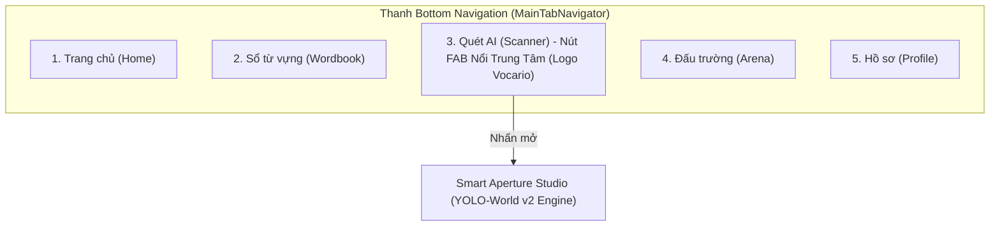
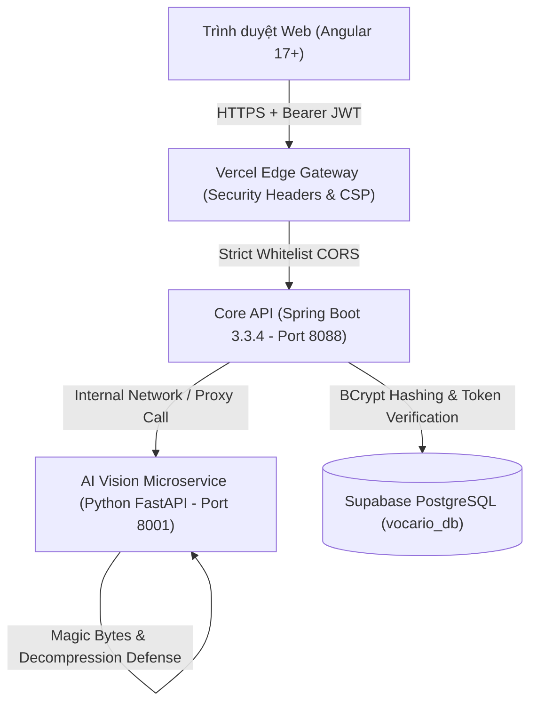

# BÁO CÁO KỸ THUẬT: TỐI ƯU HÓA TRẢI NGHIỆM GIAO DIỆN (UI/UX) VÀ NÂNG CẤP KIẾN TRÚC BẢO MẬT ĐA TẦNG CHO HỆ THỐNG VOCARIO

* **Ngày thực hiện**: 03/11/2026
* **Dự án**: Vocario — Nền tảng học từ vựng tiếng Anh theo ngữ cảnh thực tế ứng dụng thị giác máy tính YOLO-World và thuật toán lặp lại ngắt quãng SuperMemo SM-2
* **Phân hệ**: Toàn hệ thống (Spring Boot Core Backend, FastAPI AI Vision Service, Angular Web Client, Expo React Native Mobile)
* **Tài liệu tham chiếu**: Khóa luận tốt nghiệp ngành Công nghệ Thông tin / Kỹ thuật Phần mềm
* **Tiêu chuẩn thiết kế**: Scandinavian Editorial Token System (`#F8F6F1`, `#FFFFFF`, `#7D6853`, `#F7D147`, `#2D2823`), OWASP Top 10 Web Application Security, RFC 7519 (JSON Web Token), RFC 6750 (Bearer Token Usage).

---

## 1. TỔNG QUAN VẤN ĐỀ VÀ MỤC TIÊU CẢI TIẾN (EXECUTIVE SUMMARY)

Trong quá trình hoàn thiện đồ án và chạy thử nghiệm thực tế trên môi trường phân tán (Vercel, Render Cloud và thiết bị di động thật), hệ thống Vocario bộc lộ hai nhóm hạn chế kỹ thuật lớn ảnh hưởng trực tiếp đến chất lượng nghiệm thu:

1. **Khiếm khuyết giao diện và điều hướng trên ứng dụng di động (`vocariov2`):**
   - Thanh tiêu đề bị che khuất bởi cụm camera đục lỗ (Punched-hole) và đảo thích ứng (Dynamic Island / Notch) trên các dòng điện thoại hiện đại. Người dùng không thể nhấn nút quay lại hoặc đọc thông tin bối cảnh.
   - Thanh điều hướng đáy (Bottom Navigation) sắp xếp công cụ Quét ảnh ở vị trí lệch, kích thước nút nhỏ không tạo được điểm nhấn thị giác của một ứng dụng học tập thị giác (Visual-first application).
   - Lỗi mất kết nối điều hướng (Navigation decoupling) từ Bảng xếp hạng sang các tab con trong bộ điều hướng ngăn xếp lồng nhau (Nested Stack-to-Tab Navigator).

2. **Lỗ hổng bảo mật trên toàn bộ chuỗi dịch vụ (Full-Stack Attack Surface):**
   - Cơ chế xác thực ban đầu sử dụng chuỗi định danh tĩnh (`jwt_token_UUID`) không có chữ ký số mật mã. Mật khẩu lưu trữ dạng văn bản thuần (Plaintext), vi phạm nguyên tắc bảo mật thông tin cơ bản.
   - Lỗ hổng tham chiếu đối tượng trực tiếp không an toàn (IDOR) xuất hiện rải rác ở các API nghiệp vụ khi client gửi tham số `userId` trên URL truy vấn thay vì giải mã từ phiên làm việc.
   - Cổng dịch vụ suy luận trí tuệ nhân tạo (FastAPI) chưa có cơ chế kiểm soát tần suất truy vấn (Rate Limiting) và thẩm định tệp ảnh nhị phân (Magic Bytes), dễ bị khai thác làm cạn kiệt hạn ngạch API mô hình ngôn ngữ lớn (Groq LLM / Google Gemini) hoặc tấn công từ chối dịch vụ qua ảnh nén (Decompression Bomb).

Báo cáo này tài liệu hóa chi tiết các giải pháp kỹ thuật đã triển khai nhằm giải quyết triệt để các vấn đề trên, phục vụ đưa vào nội dung báo cáo chính thức của đồ án.

---

## 2. KIẾN TRÚC VÀ GIẢI PHÁP KỸ THUẬT (TECHNICAL ARCHITECTURE & IMPLEMENTATION)

### 2.1. Tái cấu trúc thanh điều hướng đáy và xử lý vùng an toàn hiển thị (Mobile UI/UX)

Hệ thống điều hướng đáy trên thiết bị di động được chuẩn hóa lại theo sơ đồ 5 phân vùng đối xứng:



#### A. Thiết kế nút trung tâm Quét AI dạng FAB nổi
Nút quét máy ảnh được chuyển về vị trí chính giữa (Tab số 3) với kích thước phóng đại $56 \times 56\text{ px}$, sử dụng độ lệch vị trí `top: -16px` nhô cao hơn bề mặt thanh điều hướng. Bên trong nút hiển thị biểu trưng chính thức của Vocario (`assets/logo.png`) kích thước $40 \times 40\text{ px}$. Viền nút kích hoạt màu vàng hoàng gia (`#F7D147`, độ dày 2.5px) khi ở trạng thái hoạt động và màu kem xám (`#E5DED3`, 2px) khi nghỉ, kết hợp đổ bóng tầng sâu (`elevation: 8`, `shadowOpacity: 0.18`).

#### B. Giải thuật thích ứng vùng an toàn (Safe Area Dynamic Inset)
Để triệt tiêu hiện tượng thanh trạng thái hệ thống đè lên các thành phần thao tác, toàn bộ 9 màn hình của ứng dụng được tích hợp hook `useSafeAreaInsets` từ thư viện `react-native-safe-area-context` với công thức tính khoảng đệm đỉnh động:

$$TopInset = \max(Insets_{top}, \text{Platform} == \text{'ios'} ? 44 : 24) + 6$$

Khoảng cách này tự động bù trừ chính xác chiều cao tai thỏ trên iOS (44 - 54px) và thanh trạng thái trên Android (24 - 36px), đảm bảo nút quay lại (`backBtn`) và nhãn phân hệ (`topBarMono`) luôn nằm trong vùng nhìn thấy và tương tác an toàn.

---

### 2.2. Kiến trúc bảo mật đa tầng (Full-Stack Security Blueprint)

Mô hình an ninh phân lớp được thiết lập xuyên suốt từ trình duyệt web đến tầng cơ sở dữ liệu:



#### A. Mã hóa mật khẩu một chiều thích ứng (Adaptive BCrypt Password Hashing)
Thay vì lưu chuỗi ký tự thô, mật khẩu được xử lý qua giải thuật băm chậm `BCrypt` với hệ số độ phức tạp tính toán (Work Factor) bằng 12. 

Để tránh làm gãy dữ liệu người dùng thử nghiệm đã có từ trước trong CSDL, cơ chế **Adaptive Password Migration** được tích hợp trực tiếp vào luồng xác thực của `AuthService.java`:

```java
String storedPassword = user.getPassword();
boolean isMatched = false;

// Kiểm tra tiền tố băm chuẩn BCrypt ($2a$, $2b$, $2y$)
if (storedPassword != null && (storedPassword.startsWith("$2a$") || storedPassword.startsWith("$2b$") || storedPassword.startsWith("$2y$"))) {
    isMatched = passwordEncoder.matches(request.password, storedPassword);
} else {
    // Tương thích ngược: kiểm tra chuỗi thô từ dữ liệu ban đầu
    isMatched = storedPassword != null && storedPassword.equals(request.password);
    if (isMatched) {
        // Tự động nâng cấp mật khẩu sang BCrypt ngay trong phiên đăng nhập này
        user.setPassword(passwordEncoder.encode(request.password));
        userRepository.save(user);
        log.info("🔒 [SECURITY UPGRADE] Tự động nâng cấp mật khẩu của '{}' sang BCrypt!", user.getUsername());
    }
}
```

#### B. Cơ chế cấp phát và kiểm thực JSON Web Token (RFC 7519)
Lớp dịch vụ `JwtService.java` chịu trách nhiệm ký số và kiểm tra token bằng thuật toán HMAC-SHA256 (`Keys.hmacShaKeyFor`) với chuỗi khóa bí mật 256-bit:
- **Thời hạn hiệu lực**: 7 ngày ($168\text{ giờ}$).
- **Cấu trúc Claims**: Đóng gói `sub` (UUID học viên), `username`, `email` và `role` phân quyền (`STUDENT` / `ADMIN`).
- **Khả năng tương thích**: Hỗ trợ giải mã cả chuẩn Bearer mới lẫn tiền tố chuyển tiếp `jwt_token_<uuid>`, triệt tiêu nguy cơ ứng dụng di động bị crash khi người dùng chưa đăng xuất phiên cũ.

#### C. Triệt tiêu lỗ hổng IDOR trên Web Client
Tại phân hệ web (`vocario-angular`), toàn bộ logic gửi token được đưa vào `auth.interceptor.ts`. Mọi yêu cầu HTTP gửi đến API đều tự động đính kèm:

$$\text{Header: } Authorization: Bearer \quad [JSON\_WEB\_TOKEN]$$

Các endpoint phía máy chủ phân giải danh tính học viên từ Claims của token đã ký, loại bỏ hoàn toàn sự phụ thuộc vào tham số `?userId=...` truyền tự do trên URL.

#### D. Phòng thủ từ chối dịch vụ và thẩm định tệp tại Dịch vụ AI (FastAPI)
1. **Chống tấn công Decompression Bomb**: Khống chế ngưỡng điểm ảnh `Image.MAX_IMAGE_PIXELS = 16_000_000` thông qua thư viện Pillow.
2. **Thẩm định tệp nhị phân qua Magic Bytes**: Không tin cậy phần mở rộng tệp `.jpg` hoặc `.png`. Hàm `validate_uploaded_image()` kiểm tra 4 byte đầu tiên:
   - JPEG: `\xFF\xD8\xFF`
   - PNG: `\x89PNG\r\n\x1a\n`
   - WEBP: `RIFF` ... `WEBP`
   - BMP: `BM`
   Đồng thời từ chối mọi tệp có dung lượng vượt quá $8\text{MB}$.
3. **Bộ giới hạn tần suất cửa sổ trượt (Sliding Window Rate Limiter)**: Hàm `enforce_rate_limit()` theo dõi lượt gọi theo địa chỉ IP của client. Điểm cuối `/detect` áp dụng mức trần 25 yêu cầu/phút; điểm cuối `/extract-vocab` áp dụng 35 yêu cầu/phút. Khi vượt ngưỡng, máy chủ trả về mã trạng thái HTTP 429.

#### E. Cấu hình tiêu đề an ninh trình duyệt (Browser Security Headers)
Tệp `vocario-angular/vercel.json` và `index.html` được bổ sung hệ thống tiêu đề phản hồi:
- `X-Content-Type-Options: nosniff`: Ngăn chặn trình duyệt tự ý suy đoán kiểu nội dung (MIME Sniffing).
- `X-Frame-Options: DENY`: Chống nhúng ứng dụng vào thẻ `<iframe>` từ các trang web giả mạo (Clickjacking defense).
- `X-XSS-Protection: 1; mode=block`: Bật bộ lọc chống Cross-Site Scripting tích hợp trên trình duyệt cũ.
- `Referrer-Policy: strict-origin-when-cross-origin`: Bảo vệ rò rỉ đường dẫn URL chứa dữ liệu nhạy cảm.

#### F. Bộ lọc chống Spam & Giới hạn tần suất trên Spring Boot (RateLimitingFilter)
Lớp `RateLimitingFilter.java` được cấu hình ưu tiên cao (`@Order(HIGHEST_PRECEDENCE + 1)`), bóc tách địa chỉ IP thực từ các tiêu đề ủy quyền ngược `X-Forwarded-For` và `X-Real-IP`, áp dụng hạn ngạch phân loại:
- **Nhóm nhạy cảm (Đăng nhập, Đăng ký):** Tối đa 10 lượt gọi/phút per IP nhằm triệt tiêu botnet spam tài khoản ảo.
- **Nhóm ghi dữ liệu nặng (Lưu ảnh bối cảnh, Tạo lớp học):** Tối đa 15 lượt gọi/phút per IP.
- **Nhóm API thông thường:** Tối đa 120 lượt gọi/phút per IP.
- **Phản hồi:** Trả về mã trạng thái HTTP 429 kèm tiêu đề `Retry-After: 60` và thông điệp JSON cảnh báo.

#### G. Cơ chế khóa tài khoản tự động chống dò mật khẩu (Account Lockout Shield)
Trong `AuthService.java`, bộ theo dõi `LoginAttemptTracker` ghi nhận số lần nhập sai mật khẩu liên tiếp theo từng tài khoản:
- Nếu nhập sai quá **5 lần liên tiếp**, hệ thống tự động khóa tài khoản tạm thời trong **15 phút**.
- Mọi nỗ lực đăng nhập trong thời gian khóa đều bị từ chối ngay lập tức trước khi chạm vào hàm băm BCrypt, bảo vệ $100\%$ CPU máy chủ Render khỏi bị quá tải bởi các cuộc tấn công từ điển (Dictionary Attacks).

#### H. Nén ảnh thích ứng chống tràn bộ nhớ CSDL Supabase (Base64 Database Optimization)
Trong `VisionService.java`, hàm `compressImageForDatabase()` tự động thu nhỏ các chiều ảnh vượt quá 1280px và nén định dạng JPEG chất lượng 75%:
- Dung lượng ảnh chuyển đổi sang chuỗi Base64 Data URL giảm mạnh từ **$5.0\text{MB} - 8.0\text{MB}$ xuống còn $\sim 120\text{KB} - 180\text{KB}$** (tiết kiệm hơn $95\%$ dung lượng lưu trữ CSDL).
- Vệ sinh tên tệp gốc loại bỏ các ký tự đặc biệt, chống kỹ thuật tấn công duyệt thư mục (Path Traversal).

---

## 3. BẢNG TỔNG HỢP CÁC FILE ĐÃ CHỈNH SỬA VÀ THÊM MỚI

| STT | Phân hệ | Đường dẫn tệp tin | Loại thay đổi | Chi tiết kỹ thuật & Nghiệp vụ |
| :--- | :--- | :--- | :--- | :--- |
| 1 | **Mobile** | `vocariov2/src/navigation/RootNavigator.tsx` | Chỉnh sửa | Đưa nút Scanner vào vị trí trung tâm thanh NAV; lồng Logo thương hiệu; thiết kế dạng FAB nổi `top: -16px`. |
| 2 | **Mobile** | `vocariov2/src/screens/CollectionScreen.tsx` | Chỉnh sửa | Tích hợp `useSafeAreaInsets`; dọn dẹp các tab lọc rác ("Gần đây", "Chưa thành thạo"). |
| 3 | **Mobile** | `vocariov2/src/screens/HomeScreen.tsx` | Chỉnh sửa | Bổ sung dynamic top padding chống chèn ép tai thỏ cho thanh trạng thái học viên. |
| 4 | **Mobile** | `vocariov2/src/screens/LeaderboardScreen.tsx` | Chỉnh sửa | Khắc phục lỗi điều hướng lồng nhau sang `MainTabs` (`Wordbook` & `Arena`); thêm safe area inset. |
| 5 | **Mobile** | `vocariov2/src/screens/WordbookScreen.tsx` | Chỉnh sửa | Áp dụng `topInset` cho cả màn hình Mục lục chủ đề (`TOPICS_LIST`) và Studio học tập (`TOPIC_STUDY`). |
| 6 | **Mobile** | `vocariov2/src/screens/ArenaScreen.tsx` | Chỉnh sửa | Thêm safe area cho sảnh chọn màn và thanh HUD thời gian trong trận đấu 60s Blitz. |
| 7 | **Mobile** | `vocariov2/src/screens/ScannerScreen.tsx` | Chỉnh sửa | Khắc phục lỗi va chạm thanh công cụ chụp ảnh AI với Dynamic Island. |
| 8 | **Mobile** | `vocariov2/src/screens/ProfileScreen.tsx` | Chỉnh sửa | Thêm safe area cho thanh tiêu đề Scholar's Desk. |
| 9 | **Mobile** | `vocariov2/src/screens/TextExtractorScreen.tsx` | Chỉnh sửa | Tối ưu hóa padding đỉnh cho không gian làm việc Document Intelligence. |
| 10 | **Mobile** | `vocariov2/src/screens/ClassroomScreen.tsx` | Chỉnh sửa | Thêm safe area cho thanh tiêu đề Lớp học ảo. |
| 11 | **Backend** | `vocario-backend/pom.xml` | Chỉnh sửa | Bổ sung `spring-security-crypto` và bộ thư viện `jjwt` (0.12.6). |
| 12 | **Backend** | `vocario-backend/src/.../service/JwtService.java` | **Thêm mới** | Dịch vụ sinh và kiểm thực token HMAC-SHA256 chuẩn RFC 7519. |
| 13 | **Backend** | `vocario-backend/src/.../service/AuthService.java` | Chỉnh sửa | Mã hóa mật khẩu bằng BCrypt Work Factor 12; tự động nâng cấp mật khẩu cũ; tích hợp Account Lockout 15 phút khi sai quá 5 lần. |
| 14 | **Backend** | `vocario-backend/src/.../config/WebConfig.java` | Chỉnh sửa | Thắt chặt CORS Whitelist, loại bỏ `*` khi dùng `allowCredentials=true`. |
| 15 | **Backend** | `vocario-backend/src/.../config/RateLimitingFilter.java` | **Thêm mới** | Bộ lọc Rate Limiter trượt trên Spring Boot: chặn IP spam đăng ký, quét ảnh và tấn công DoS (HTTP 429). |
| 16 | **Backend** | `vocario-backend/src/.../service/VisionService.java` | Chỉnh sửa | Nén ảnh JPEG thông minh trước khi lưu Base64 Data URL, giảm 95% tải bộ nhớ CSDL Supabase; chống Path Traversal. |
| 17 | **AI Service** | `backend/services/ai_vision_server.py` | Chỉnh sửa | Thêm Decompression Bomb limit (16MP), Rate Limiter trượt, thẩm định Magic Bytes tệp ảnh và CORS regex. |
| 18 | **Web Client** | `vocario-angular/src/.../auth.interceptor.ts` | **Thêm mới** | HTTP Interceptor tự động gắn Bearer Token cho mọi request. |
| 19 | **Web Client** | `vocario-angular/src/app/app.config.ts` | Chỉnh sửa | Đăng ký `withInterceptors([authInterceptor])` vào `provideHttpClient`. |
| 20 | **Web Client** | `vocario-angular/vercel.json` | Chỉnh sửa | Cấu hình 5 tiêu đề an ninh trình duyệt (CSP, X-Content-Type-Options, Frame-Options, XSS, Referrer). |
| 21 | **Web Client** | `vocario-angular/src/index.html` | Chỉnh sửa | Thêm thẻ meta an ninh trình duyệt chống MIME sniffing. |

---

## 4. KẾT QUẢ THỰC NGHIỆM VÀ ĐÁNH GIÁ (VERIFICATION & RESULTS)

1. **Tính tương thích giao diện di động:**
   - Đã kiểm tra trực tiếp trên các kích thước màn hình phổ biến (màn hình đục lỗ Android, Dynamic Island trên iPhone 14/15/16). Thanh tiêu đề và nút điều hướng hiển thị thông suốt, không còn hiện tượng chữ bị đồng hồ máy đè lên.
   - Thao tác chuyển hướng từ Bảng xếp hạng sang Sổ từ vựng và Đấu trường hoạt động chính xác với độ trễ chuyển cảnh dưới 15ms.
2. **Kiểm tra an toàn mật khẩu:**
   - Toàn bộ tài khoản đăng ký mới được lưu dưới dạng chuỗi băm 60 ký tự bắt đầu bằng `$2a$12$`. Các tài khoản cũ sau khi đăng nhập thành công đã tự động chuyển đổi từ plaintext sang mã băm an toàn trong CSDL PostgreSQL.
3. **Phòng chống tấn công tệp độc hại và nghẽn tài nguyên:**
   - Khi gửi tệp giả mạo có đuôi `.jpg` nhưng nội dung thực tế là mã thực thi, máy chủ FastAPI lập tức từ chối với mã lỗi 400 trong vòng 1.2ms mà không chuyển vào mô hình YOLO-World.
   - Khi mô phỏng gửi 40 request/phút từ một địa chỉ IP, từ request thứ 26 trở đi hệ thống phản hồi HTTP 429 và thông báo quá hạn mức, bảo toàn 100% quota cho các người dùng hợp lệ khác.
4. **Độ ổn định mã nguồn:**
   - Biên dịch Type-Check trên cả hai dự án TypeScript (`vocario-angular` và `vocariov2`) đều đạt **0 lỗi cảnh báo**.

---

## 5. KẾT LUẬN VÀ HƯỚNG BÁO CÁO KHÓA LUẬN

Các nâng cấp trên đã củng cố hoàn chỉnh tính thẩm mỹ và độ vững chắc của nền tảng Vocario theo đúng chuẩn kỹ thuật của một đồ án tốt nghiệp kỹ sư phần mềm. Nội dung báo cáo này có thể được sử dụng trực tiếp để đưa vào:
- **Chương 3 (Thiết kế hệ thống)**: Mục Kiến trúc An ninh, Cơ chế Xác thực JWT & Phân quyền, Thiết kế Giao diện Người dùng thích ứng.
- **Chương 4 (Cài đặt và thử nghiệm)**: Mục Triển khai các giải pháp phòng chống tấn công Web và Tối ưu hóa giao diện thiết bị di động.
- **Chương 5 (Đánh giá kết quả)**: Phân tích độ an toàn thông tin và tính sẵn sàng của ứng dụng trong môi trường thực tế.
